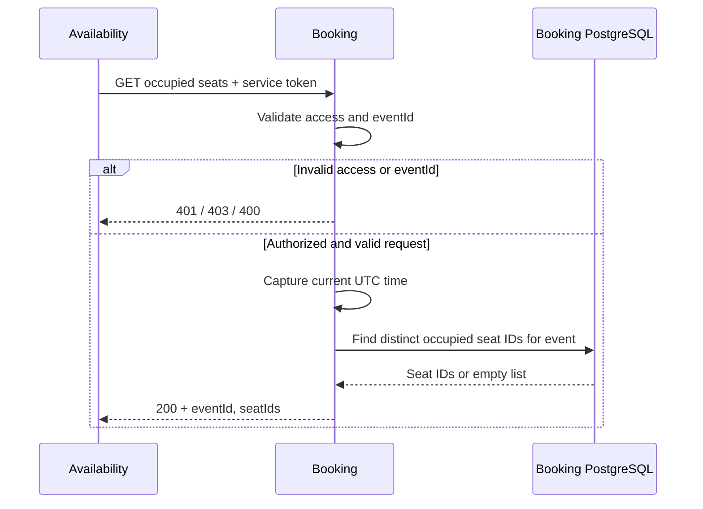

# Occupied seats contract

Proposed contract for #21, consumed by Availability in #13.

## Request

```http
GET /api/events/{eventId}/occupied-seats
Authorization: Bearer <service-token>
```

`eventId` is a valid, non-empty UUID. No request body.
Availability uses `availability-service`; authentication and permissions are configured in #11.

## Response: 200 OK

Content-Type: `application/json`. Both fields are always included; `seatIds` contains distinct seat UUIDs for the requested event.

```json
{
  "eventId": "72aa37d0-dcc2-40a5-9816-b9fc336014d6",
  "seatIds": ["794e232a-21b9-4ce9-b9fa-2eb14ab276ed"]
}
```

Evaluate expiration against one UTC instant captured for the query.

| Reservation | Included |
|-------------|----------|
| Confirmed | Yes |
| Retained with `ExpiresAt` after that instant | Yes |
| Retained with `ExpiresAt` at or before that instant | No, even before the expiration job runs (#20) |
| Retained with `ExpiresAt = null` | Yes, consistent with the reservation status endpoint |
| Rejected or Expired | No |

No matches returns `200` with `seatIds: []`. Availability owns the event catalog; Booking does not validate event existence or return `404` for an event without reservations.
This query does not modify reservations.

## Errors

| HTTP status | Meaning |
|-------------|---------|
| 400 | Invalid or empty UUID. |
| 401 | Missing, invalid or expired service token. |
| 403 | Valid token without the required permissions. |
| 5xx | Server failure; must not be reported as an empty seat list. |

400 uses Problem Details (`application/problem+json`) with `type`, `title`, `status` and `detail`.
Clients use the HTTP status, not error text. No JSON body is required for 401/403.

## Sequence


