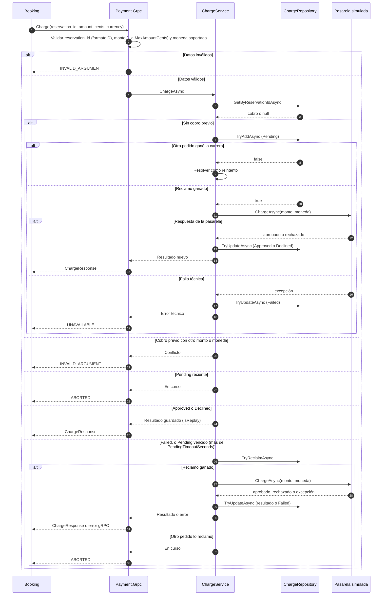

# Contrato Booking → Payment

> Estado: implementado en #22. Fuente de verdad del `.proto`: `src/Contracts/Protos/payment.proto`.
> Este documento describe el contrato y las reglas de negocio. El detalle de implementación vive en el código de `Payment.Business`.

## 1. Propósito

Payment cobra una reserva retenida. Recibe el id de la reserva, el monto y la moneda, y responde si el cobro quedó aprobado o rechazado. Payment no conoce asientos, eventos ni usuarios: solo cobra.

Payment es el único servicio que escribe en su base. Booking no lee la base de Payment.

## 2. Contrato RPC

```proto
service PaymentService {
  rpc Charge (ChargeRequest) returns (ChargeResponse);
}
```

| Campo | Tipo | Regla |
|---|---|---|
| `reservation_id` | string (Guid) | Obligatorio, en formato `xxxxxxxx-xxxx-xxxx-xxxx-xxxxxxxxxxxx` (el de `Guid.ToString()`; sin llaves). Es la clave de idempotencia: una reserva tiene como máximo un cobro. |
| `amount_cents` | int64 | Entre 1 y `Charge:MaxAmountCents` (100.000.000, un millón de pesos). Monto fijo por asiento, en centavos enteros. Lo configura Booking en `Payment:AmountCents`. |
| `currency` | string | Código ISO 4217 incluido en `Charge:SupportedCurrencies` de Payment, con mayúsculas exactas. Por ahora solo `ARS`. |

Metadata opcional: `x-correlation-id`, el `correlationId` del mensaje original (#24). Payment lo agrega a sus logs si tiene hasta 64 caracteres entre letras, dígitos, `-`, `_`, `.` y `:`; si no, lo registra como `invalido`. Un valor inválido nunca rechaza el cobro.

Respuesta `ChargeResponse`:

| Campo | Tipo | Regla |
|---|---|---|
| `status` | `ChargeStatus` | `APPROVED` o `DECLINED`. `UNSPECIFIED` nunca se devuelve. |
| `charge_id` | string | Id del cobro en Payment, para trazabilidad. |
| `failure_reason` | string | Solo si `status` es `DECLINED`. |

Un rechazo de negocio viaja en la respuesta. Un error técnico viaja como código de estado gRPC.

## 3. Códigos de respuesta y cómo los interpreta Booking

| Respuesta de Payment | Significado | Qué hace Booking |
|---|---|---|
| `OK` + `APPROVED` | Cobro aprobado | Confirma la reserva. |
| `OK` + `DECLINED` | Rechazo de negocio | Rechaza con motivo `PaymentFailed`. |
| `ABORTED` | Hay un cobro en curso para esta reserva (`Pending`) | Reintenta con la misma clave, sin cobrar de nuevo. |
| `UNAVAILABLE` | Falla transitoria: Payment no responde, la pasarela tuvo un error técnico (el cobro quedó `Failed`, sin cargo) o la base de Payment no está disponible | Reintenta con la misma clave. Si se agotan los reintentos, rechaza con `PaymentUnavailable` y registra "posible cobro tardío, resultado desconocido". |
| `DEADLINE_EXCEEDED` | Payment no respondió dentro del deadline de Booking | Igual que `UNAVAILABLE`. |
| `INVALID_ARGUMENT` | Datos inválidos, moneda no soportada o mismo `reservation_id` con otro monto o moneda | No reintenta. Deriva el mensaje a la DLQ para revisión manual; la reserva queda retenida hasta que vence. |
| `INTERNAL` | Error interno de Payment que reintentar no arregla (por ejemplo, un modo simulado mal configurado) | No reintenta. Lo trata como respuesta inesperada y lo deriva a revisión manual. |
| `UNKNOWN` | Excepción no prevista, incluido un error de base no transitorio (credenciales, SQL) | Igual que `INTERNAL`. |
| `UNAUTHENTICATED` / `PERMISSION_DENIED` | Token inválido o sin el rol necesario | Error de configuración. Fuera del alcance de este PR: lo implementa #11 (ver sección 9). |

## 4. Estados del cobro

| Estado | Significado | Qué responde Payment a un nuevo pedido con la misma reserva |
|---|---|---|
| `Pending` | El cobro está reclamado y la pasarela todavía no respondió | `ABORTED`. Si el reclamo tiene más de `Charge:PendingTimeoutSeconds` (60 s), se considera abandonado y se reclama de nuevo, como un `Failed` |
| `Approved` | La pasarela aprobó el cobro | Resultado guardado, sin cobrar de nuevo |
| `Declined` | La pasarela rechazó el cobro (fondos, tarjeta) | Resultado guardado, sin cobrar de nuevo |
| `Failed` | Error técnico. En la simulación no hubo cargo | Reclama el cobro con un `UPDATE` condicional y lo intenta de nuevo. Si otro pedido lo reclamó primero, responde `ABORTED`. |

Transiciones:

```
(sin cobro) → Pending → Approved
                     → Declined
                     → Failed → Pending   (reintento)
                     → Pending            (reclamo de un Pending vencido)
```

Un cobro `Approved` o `Declined` nunca vuelve a cobrarse. Un cobro `Failed` puede reintentarse, pero solo si nadie lo tiene reclamado.

### Cobro `Pending` abandonado

Si Payment se cae a mitad de un cobro, la fila queda `Pending` y nadie la termina. Cada reclamo registra `claimed_at`; cuando pasan más de `Charge:PendingTimeoutSeconds` (60 s por defecto), el siguiente pedido con la misma reserva lo reclama con el mismo `UPDATE` condicional que se usa para `Failed` y vuelve a cobrar. Payment no arranca si el umbral no supera `SimulatedGateway:SlowDelaySeconds`.

`claimed_at` es además un token de concurrencia: si un cobro lento termina después de que otro pedido lo reclamó, su resultado se descarta (log `Resultado descartado`) y no pisa el del pedido vigente.

> **Riesgo con una pasarela real.** Un `Pending` vencido puede ser un cargo que la pasarela hizo y cuya respuesta se perdió. Reclamarlo cobraría dos veces. Con la pasarela simulada no hay cargo real; con una real habría que consultar a la pasarela antes de reclamar. Cada reclamo de un `Pending` vencido deja un log `warn` ("Cobro Pending abandonado") con el `claimed_at` original para el cotejo.

## 5. Reglas de idempotencia

- Una reserva tiene como máximo un cobro. Lo garantiza un índice único sobre `ReservationId` en la base.
- Antes de cobrar, el cobro se guarda como `Pending`. Así dos pedidos simultáneos no cobran dos veces: el índice único decide quién gana.
- Si un pedido llega con el mismo `reservation_id` pero con otro monto o moneda, responde `INVALID_ARGUMENT`. No se devuelve el resultado guardado como si coincidiera.
- Un reintento de Booking tras perder la respuesta devuelve el resultado guardado y no genera un segundo cargo.

## 6. Reglas de negocio

| Regla | Quién la decide | Detalle |
|---|---|---|
| Un asiento por solicitud | Issue #22 | Una reserva, un cobro. No hay cantidad. |
| Precio fijo por asiento | Issue #22 | `Payment:AmountCents` en Booking. Availability no conoce el precio. |
| Solo ARS por ahora | Issue #22 | Ampliable con `SupportedCurrencies` sin cambiar el contrato. |
| `Failed` significa que no hubo cargo | Issue #22 | Vale para la pasarela simulada. Con una pasarela real, un timeout no lo garantiza. |
| No hay reembolso automático | Issue #22 | Un cobro aprobado para una reserva ya vencida o rechazada se resuelve manualmente. |
| Cotejo manual | Issue #22 | Lo hace Payment consultando la tabla de cobros por `reservation_id`. Booking no consulta la base de Payment. |
| No hay RPC de consulta ni de reembolso | Issue #22 | Se evita agregar superficie al contrato en esta etapa. |

### Procedimiento de cotejo

1. Booking registra "posible cobro tardío, resultado desconocido" cuando agota los reintentos con `UNAVAILABLE`, `DEADLINE_EXCEEDED` o `ABORTED`.
2. El responsable de Payment consulta la tabla de cobros por `reservation_id`.
3. Si el cobro está `Approved` y la reserva está `Rejected` o `Expired`, se inicia el reembolso manual y se registra el caso.
4. Si el cobro está `Failed` o `Pending`, no hay cargo que revertir.

## 7. Modos de la pasarela simulada

Se elige con `SimulatedGateway:Mode` por variable de entorno, sin depender del monto.

| Modo | Comportamiento | Para qué sirve en la demo |
|---|---|---|
| `Approve` | Cobro aprobado | Happy path |
| `Decline` | Rechazo por fondos insuficientes | Pago fallido |
| `Slow` | Demora `SlowDelaySeconds` (15 s) y luego aprueba | Timeout de Booking y reintento idempotente |
| `Error` | Excepción técnica, el cobro queda en `Failed` y Payment responde `UNAVAILABLE` | Pago no disponible |

Bajar el contenedor de Payment también cubre el caso "pago no disponible" desde el lado de Booking.

## 8. Diagrama de secuencia



## 9. Fuera de alcance

| Tema | Estado | Detalle |
|---|---|---|
| Autenticación entre servicios | Pendiente en #11 | Payment hoy no valida tokens. #11 agrega client credentials con Keycloak; ahí aparecen `UNAUTHENTICATED` y `PERMISSION_DENIED`. |
| Doble cobro con pasarela real | Limitación conocida | Con una pasarela real, reclamar un `Pending` vencido, o un `Pending` que dejó una actualización fallida tras la aprobación, puede cobrar dos veces. La mitigación sería consultar a la pasarela antes de reclamar. |
| Modo `Expire` de la pasarela | Descartado | La expiración de la reserva es de Booking (#19 y #20). Se prueba con su reloj controlado, no con una demora de Payment. |
| RPC de consulta y de reembolso | Descartado en esta etapa | El cotejo y el reembolso son manuales (sección 6). |

## 10. Acuerdos con Booking (#19)

1. `ABORTED` agotado: el mensaje va a la DLQ y la reserva queda `Retained` hasta que #20 la vence.
2. Error técnico de la pasarela y base caída: `UNAVAILABLE`, que Booking reintenta.
3. El "posible cobro tardío" queda en los logs de Booking (`ErrorCode=PaymentOutcomeUnknown`); el cotejo sigue la sección 6.
4. `INVALID_ARGUMENT`: DLQ y revisión manual.
5. Deadline gRPC de Booking: 5 s propuestos, configurable. Tiene que ser menor que `SlowDelaySeconds` para que el modo `Slow` provoque el timeout. Pendiente de implementar en el adaptador de Booking.

## 11. Historial

| Fecha | Cambio |
|---|---|
| 2026-11-02 | Versión inicial. Modo `Expire` fuera de alcance. Entidad `Charge`, tabla `charges`. |
| 2026-11-04 | El error técnico de la pasarela y la base caída responden `UNAVAILABLE` (antes `INTERNAL`). Se documentan `INTERNAL`, `UNKNOWN` y lo que queda fuera de alcance. El documento pasa a `docs/contracts/`. |
| 2026-11-04 | Un cobro `Pending` abandonado se reclama después de `Charge:PendingTimeoutSeconds`. Columna `claimed_at` como token de concurrencia. |
| 2026-11-04 | Validaciones: monedas de `Charge:SupportedCurrencies`, tope `Charge:MaxAmountCents`, `reservation_id` solo en formato `D` y límites de `x-correlation-id`. |
