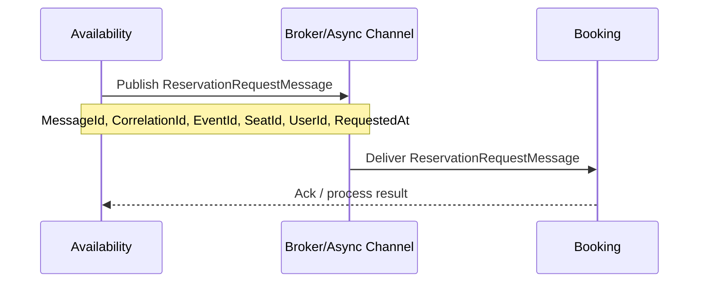

# Reservation Request Contract

Este contrato representa la solicitud de reserva de un asiento emitida por `Availability` y consumida por `Booking` a través de mensajería asíncrona.

## Campos

- `MessageId`: GUID único de la solicitud.
- `CorrelationId`: identificador para rastreo distribuido.
- `EventId`: identificador único del evento.
- `SeatId`: identificador único del asiento.
- `UserId`: usuario que solicita la reserva.
- `RequestedAt`: fecha y hora UTC en la que se emitió la solicitud.

## Diagrama Mermaid



## Modelo C#

```csharp
public class ReservationRequestMessage
{
    public Guid MessageId { get; set; }
    public string CorrelationId { get; set; } = string.Empty;
    public Guid EventId { get; set; }
    public Guid SeatId { get; set; }
    public string UserId { get; set; } = string.Empty;
    public DateTime RequestedAt { get; set; } = DateTime.UtcNow;
}
```

## Ejemplo de payload

```json
{
  "messageId": "7b2f0c31-9d3a-4a4f-8d2e-0f6b11f5a245",
  "correlationId": "req-2026-10-31-001",
  "eventId": "8cc3b719-4866-4f8b-a893-6db7d0f18b55",
  "seatId": "1cf6fb92-e01e-4d7c-8935-14a42f8fd17a",
  "userId": "user-42",
  "requestedAt": "2026-10-31T12:00:00Z"
}
```
