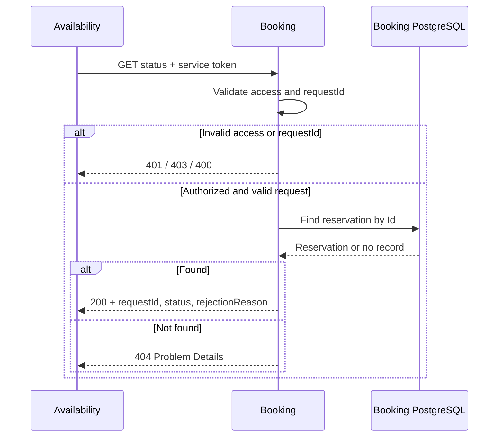

# Reservation status contract

Proposed contract for #21, consumed by Availability in #16. Implementation follows in a separate PR.

## Request

```http
GET /api/reservations/{requestId}/status
Authorization: Bearer <service-token>
```

`requestId` is a valid, non-empty UUID matching `Reservation.Id`. No request body.
Service authentication and permissions are configured in #11.

## Response: 200 OK

Content-Type: `application/json`. Property names use camelCase; enum values are strings.

```json
{
  "requestId": "c67cf9a8-cc6f-48c6-9f6c-a5b58b096d32",
  "status": "Rejected",
  "rejectionReason": "SeatTaken"
}
```

| Status | Meaning | rejectionReason |
|--------|---------|-----------------|
| Retained | Seat held while payment is processed. | null |
| Confirmed | Payment succeeded. | null |
| Rejected | Reservation failed. | SeatTaken, PaymentFailed or PaymentUnavailable |
| Expired | Retention expired. | null |

All three fields are always included. A rejected reservation also returns HTTP 200: the query succeeded.
This operation only reads the stored state; it does not process payments or change reservations.

## Errors

| HTTP status | Meaning |
|-------------|---------|
| 400 | Invalid or empty UUID. |
| 401 | Missing, invalid or expired service token. |
| 403 | Valid token without the required permissions. |
| 404 | No reservation recorded for this request ID. |
| 5xx | Server failure; must not be reported as a missing or rejected reservation. |

400 and 404 use Problem Details (`application/problem+json`) with `type`, `title`, `status` and `detail`.
Clients use the HTTP status, not error text. No JSON body is required for 401/403.

A 404 may mean Booking has not consumed the request yet; it does not imply rejection.
For a known submitted request, Availability may retry with a bounded polling policy defined in #16.

## Sequence


