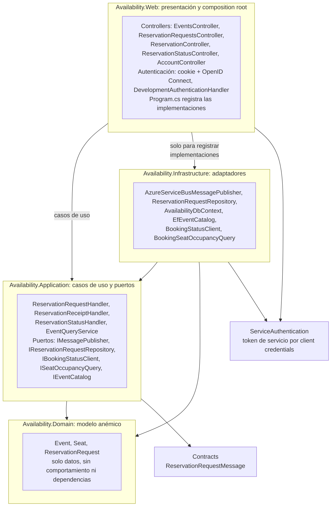
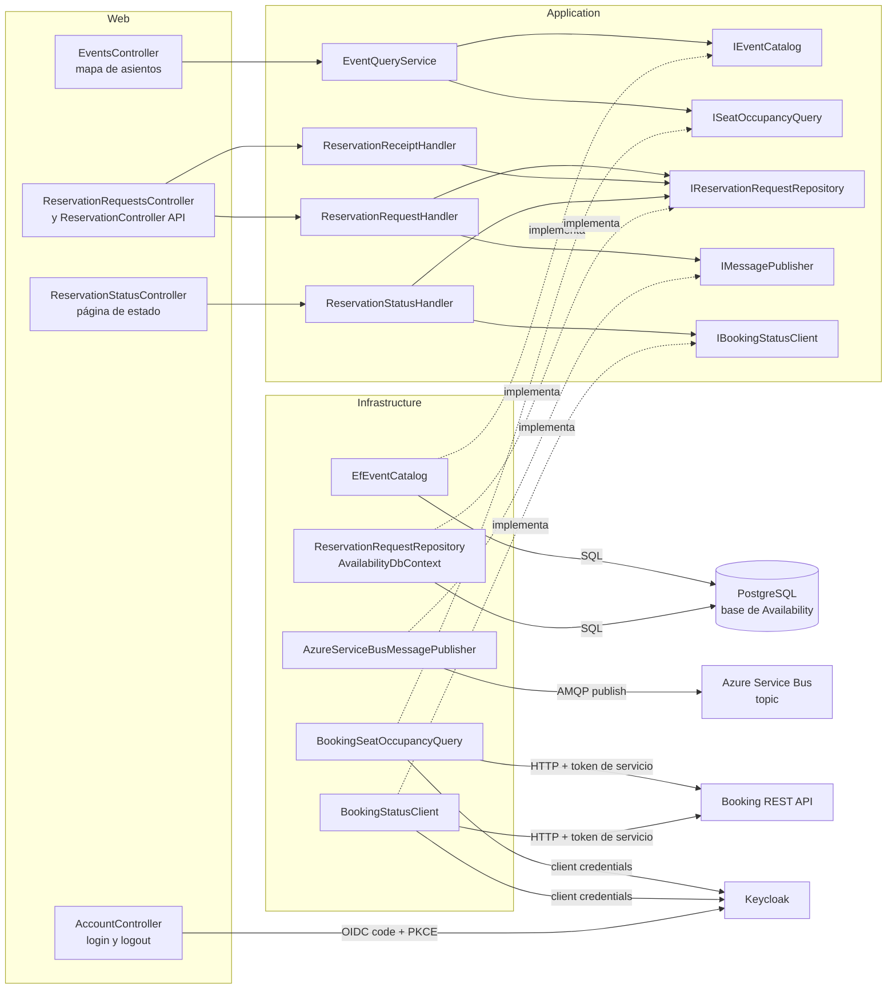

# Arquitectura de Availability (Clean Architecture)

Availability es el punto de entrada del usuario: muestra eventos y asientos, recibe solicitudes de reserva y las publica en el broker, y consulta a Booking el estado. Está organizada con Clean Architecture en cuatro proyectos: `Domain`, `Application`, `Infrastructure` y `Web`. La regla es que las dependencias apuntan hacia adentro: el negocio no conoce a PostgreSQL, a Service Bus ni a HTTP.

## Capas y dirección de las dependencias

Cada flecha es una `ProjectReference` real de los `.csproj` y se lee "depende de".

Qué hay que notar:

- `Domain` no referencia a nadie. `Application` solo depende de `Domain` y del proyecto compartido `Contracts` (el mensaje que se publica).
- `Infrastructure` depende de `Application`, no al revés: implementa las interfaces que `Application` declara. Es la inversión de dependencias.
- `Web` referencia `Infrastructure` solo para ser el punto de composición (`Program.cs` llama a `AddInfrastructure` y `AddEventQueries`). Los controladores usan únicamente tipos de `Application`.
- `Web` no tiene referencia directa a `Domain`: le llega de forma transitiva a través de `Application`.
- **Dominio anémico**: `Event`, `Seat` y `ReservationRequest` son clases con propiedades y sin métodos. Las reglas (por ejemplo, que el asiento pertenezca al evento, o compensar la solicitud si falla la publicación) viven en los casos de uso de `Application`. Los comentarios del código lo dicen: "Dominio anémico: describe los datos; los casos de uso pertenecen a Application".

## Puertos, adaptadores y sistemas externos

Los casos de uso hablan con interfaces (puertos); `Infrastructure` aporta el adaptador de cada una y es la única capa que conoce al sistema externo.

### Dónde se conecta cada sistema externo

| Sistema externo | Puerto (Application) | Adaptador (Infrastructure o Web) | Detalle |
| --- | --- | --- | --- |
| PostgreSQL | `IReservationRequestRepository`, `IEventCatalog` | `ReservationRequestRepository`, `EfEventCatalog` sobre `AvailabilityDbContext` (EF Core, Npgsql) | Guarda eventos, asientos y `reservation_requests`. No guarda ocupación ni estado de reservas: eso es de Booking. |
| Azure Service Bus | `IMessagePublisher` | `AzureServiceBusMessagePublisher` | Un `ServiceBusClient` compartido por proceso. `MessageId` es el id de la solicitud y `CorrelationId` es el `correlationId` del mensaje. |
| Booking (HTTP) | `ISeatOccupancyQuery`, `IBookingStatusClient` | `BookingSeatOccupancyQuery`, `BookingStatusClient` | Ambos clientes se registran con `AddBookingHttpClient`, que les agrega el token de `availability-service`. |
| Keycloak (usuarios) | no aplica: pertenece a la presentación | Esquema OpenID Connect en `Program.cs`, usado por `AccountController` | Client público `availability-web`, authorization code con PKCE. La cookie es el esquema por defecto. |
| Keycloak (servicios) | no aplica | `ServiceAuthentication` (`AddServiceTokenProvider`, `AddServiceBearerToken`) | Un proveedor singleton cachea el token. Sin token, la petición a Booking no se envía. |

### Adaptadores alternativos

`Program.cs` elige el adaptador según la configuración, sin tocar `Application`. Esto es justamente lo que el patrón permite.

| Puerto | Adaptador real | Alternativas |
| --- | --- | --- |
| `IMessagePublisher` | `AzureServiceBusMessagePublisher` (con `Broker:AzureServiceBus:Enabled=true`) | `LoggingMessagePublisher` (por defecto: solo registra) y `RabbitMqMessagePublisher` (marcador de posición, solo registra) |
| `IBookingStatusClient` | `BookingStatusClient` (con `Booking:BaseUrl`) | `FakeBookingStatusClient` (solo Development) y `UnavailableBookingStatusClient` |
| `IEventCatalog` y `ISeatOccupancyQuery` | `EfEventCatalog` y `BookingSeatOccupancyQuery` | `InMemoryEventCatalog` y `DemoSeatOccupancyQuery` (modo `Demo`, solo Development) |

## Fuente

- `src/Availability/Availability.Domain/Availability.Domain.csproj`, `Availability.Application.csproj`, `Availability.Infrastructure.csproj`, `Availability.Web.csproj`: grafo de `ProjectReference`.
- `src/Availability/Availability.Domain/Entities/` (`Event.cs`, `Seat.cs`, `ReservationRequest.cs`): modelo anémico.
- `src/Availability/Availability.Application/Abstractions/` y `Events/`: puertos y casos de uso.
- `src/Availability/Availability.Application/ReservationRequests/`: `ReservationRequestHandler`, `ReservationReceiptHandler`, `ReservationStatusHandler`.
- `src/Availability/Availability.Infrastructure/DependencyInjection.cs`, `Messaging/`, `Booking/`, `Events/`, `Persistence/`: adaptadores.
- `src/Availability/Availability.Web/Program.cs` y `Controllers/`: composición y presentación.
- `docs/availability-12.md`, `docs/availability-13.md`, `docs/availability-15.md`, `docs/14-autenticacion-usuarios-availability.md`, `docs/11-Autenticacion-entre-servicios.md`.
- `README.md`: sección de servicios ("Clean Architecture, anemic domain").
