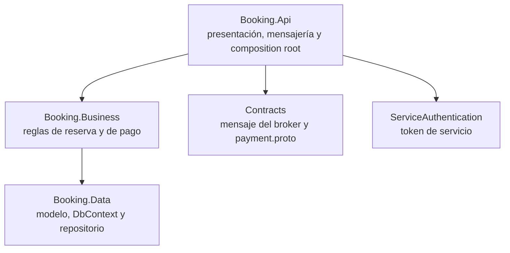
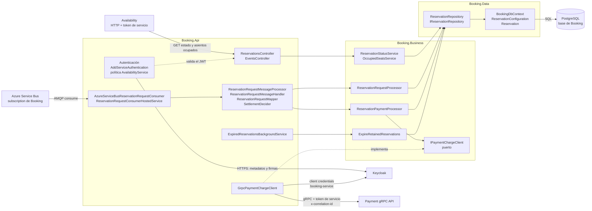

# Arquitectura de Booking (N-Layer)

Booking es el dueño de las reservas: consume las solicitudes del broker, retiene o rechaza el asiento, cobra por gRPC, confirma o rechaza según el pago, y vence las retenciones. También responde por HTTP la ocupación y el estado que le pide Availability. Está organizado en tres capas (N-Layer): `Booking.Api`, `Booking.Business` y `Booking.Data`.

## Capas y regla de dependencia

La regla es **Api, luego Business, luego Data**. Cada flecha es una `ProjectReference` real.

- `Booking.Api` **no referencia a `Booking.Data`**: no hay `ProjectReference` y ningún archivo de `Booking.Api` usa el espacio de nombres `Booking.Data`. La persistencia se registra desde `Booking.Business` (`AddBookingBusiness` llama a `AddBookingData`).
- `Booking.Data` no conoce a las capas superiores.
- Matiz: como MSBuild propaga las referencias de proyecto de forma transitiva, `Data` queda al alcance de `Api` al compilar. La separación se sostiene por convención y por la revisión del código, no porque el compilador la imponga.
- **Dominio anémico**: `Reservation` y los enums `ReservationStatus` y `ReservationRejectionReason` son datos sin comportamiento. Las transiciones de estado son actualizaciones condicionales del repositorio (por ejemplo `TrySetPaymentOutcomeAsync`, que exige estado `Retained` y `ExpiresAt` futuro).
- Un puerto invierte la dependencia hacia Payment: `Business` define `IPaymentChargeClient` y `Api` aporta el adaptador gRPC, de modo que `Business` no ve tipos de protobuf ni códigos de estado gRPC.

## Componentes

### Cómo se reparte la responsabilidad

| Capa | Componentes reales | Responsabilidad |
| --- | --- | --- |
| `Booking.Api` | `ReservationsController`, `EventsController` | Valida el id de la URL y traduce a llamadas de `Business`. Protegidos con la política `AvailabilityService` (JWT con `azp` igual a `availability-service`). |
| `Booking.Api` | `AzureServiceBusReservationRequestConsumer` y `ReservationRequestConsumerHostedService` | Consumidor del broker con `AutoCompleteMessages = false`. Se habilita por configuración. |
| `Booking.Api` | `ReservationRequestMessageProcessor`, `ReservationRequestMessageHandler`, `ReservationRequestMapper`, `ReservationRequestSettlementDecider` | Mapea y valida el mensaje (incluido el `correlationId`), invoca a `Business` y decide si completar o mandar a dead-letter. |
| `Booking.Api` | `GrpcPaymentChargeClient` | Adaptador del puerto de pago: arma la llamada gRPC con deadline, metadata `x-correlation-id` y el token `booking-service`, y traduce los códigos gRPC a fallas de `Business`. Sin pago habilitado se registra `DisabledPaymentChargeClient`. |
| `Booking.Api` | `ExpiredReservationsBackgroundService` | Job periódico (30 s por defecto) que dispara el vencimiento de retenciones. |
| `Booking.Business` | `ReservationRequestProcessor` | Intenta insertar la reserva `Retained` (10 minutos de retención por defecto). Si el asiento está tomado, persiste `Rejected/SeatTaken`. Es idempotente por el id de la solicitud. |
| `Booking.Business` | `ReservationPaymentProcessor` | Hasta 3 intentos contra Payment con la misma clave. Confirma, rechaza (`PaymentFailed`, `PaymentUnavailable`) o detecta un cobro aprobado tardío sobre una reserva ya vencida. |
| `Booking.Business` | `ExpireRetainedReservations`, `ReservationStatusService`, `OccupiedSeatsService` | Vencimiento por lotes y las dos consultas de Availability. Una reserva `Retained` vencida se informa como `Expired` aunque el job aún no la haya actualizado. |
| `Booking.Data` | `ReservationRepository`, `BookingDbContext`, `ReservationConfiguration` | Persistencia con EF Core y Npgsql. El índice único parcial sobre `(event_id, seat_id)` para `Retained` y `Confirmed` decide qué solicitud gana el asiento, también entre réplicas. |

### Dónde se conecta cada sistema externo

| Sistema externo | Punto de conexión | Detalle |
| --- | --- | --- |
| Azure Service Bus | `AzureServiceBusReservationRequestConsumer` | Un `ServiceBusProcessor` sobre topic y subscription configurados. Cada mensaje lo toma una sola réplica. |
| Payment (gRPC) | `GrpcPaymentChargeClient` | Cliente generado desde `Contracts/Protos/payment.proto`, con el token `booking-service` agregado por `AddServiceBearerToken`. Si no se obtiene el token, el error se reporta como `Unavailable` porque nada llegó a Payment. |
| Keycloak (JWT entrante) | `AddServiceAuthentication` | Valida firma, emisor, audiencia `booking-service` y vencimiento, y exige `azp` igual a `availability-service`. Con `Authority` vacío responde 401: falla cerrado. |
| Keycloak (token saliente) | `ServiceAuthentication` | Client credentials del cliente `booking-service`, con el token cacheado. |
| PostgreSQL | `BookingDbContext` | Base y usuario propios de Booking. |

## Fuente

- `src/Booking/Booking.Api/Booking.Api.csproj`, `Booking.Business.csproj`, `Booking.Data.csproj`: grafo de `ProjectReference`.
- `src/Booking/Booking.Api/Program.cs`: composición, hosted services y autenticación.
- `src/Booking/Booking.Api/Controllers/`, `Messaging/`, `Payments/`, `Reservations/`, `Authentication/`.
- `src/Booking/Booking.Business/BookingBusinessServiceCollectionExtensions.cs`, `Reservations/`, `Payments/`, `Services/`.
- `src/Booking/Booking.Data/` (`BookingDbContext.cs`, `Configurations/ReservationConfiguration.cs`, `Models/`, `Repositories/`).
- `docs/booking/consumer.md`, `docs/booking/payment-client.md`, `docs/booking/payment-dlq-review.md`, `docs/booking/authentication.md`.
- `docs/contracts/reservation-request.md`, `reservation-status.md`, `occupied-seats.md`, `payment.md`.
- `README.md`: sección de servicios ("N-Layer, anemic domain").
