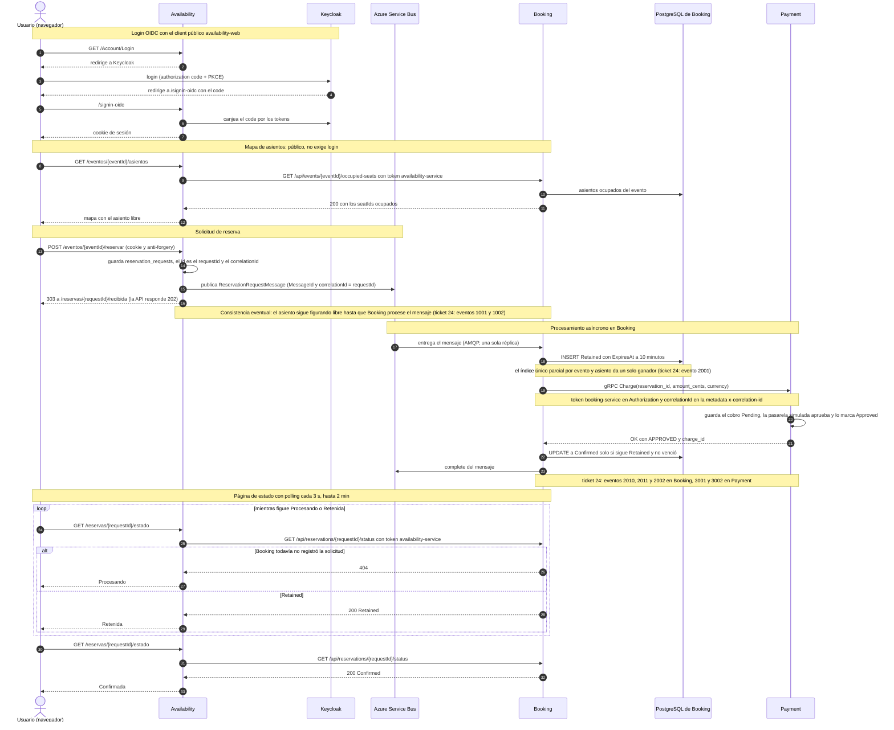
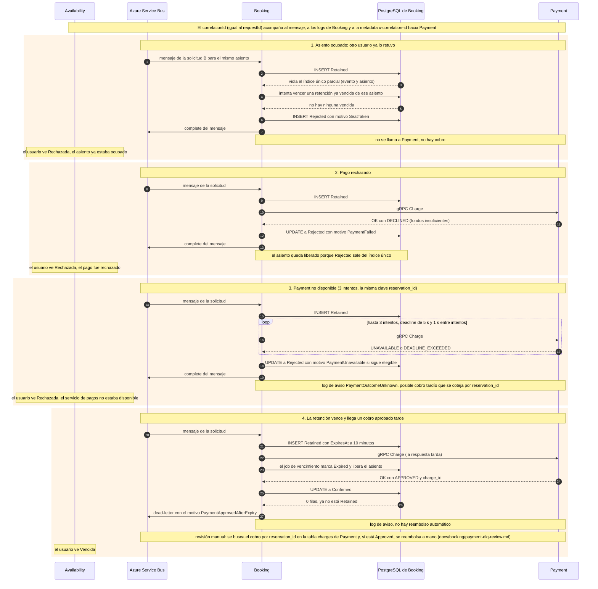

# Flujo feliz y caminos de falla (demo)

Dos diagramas de secuencia para la demo: el recorrido completo de una reserva exitosa y los cuatro caminos de falla que el sistema distingue. Los valores por defecto que aparecen (retención de 10 minutos, 3 intentos de pago, deadline de 5 segundos, polling cada 3 segundos) salen de la configuración del código y se pueden cambiar.

## Cómo viaja el correlation id

Availability genera el id de la solicitud y lo usa como `MessageId`, como `correlationId` del mensaje y como id de la reserva en Booking. Ese mismo valor es el que se ve en los tres servicios.

| Tramo | Medio | Nombre | Estado en `develop` |
| --- | --- | --- | --- |
| Usuario a Availability | HTTP | no lo manda: Availability lo genera | Implementado. |
| Availability a Booking (mensaje) | Broker | `correlationId` del cuerpo y `CorrelationId` del mensaje de Service Bus | Implementado. Booking lo valida (hasta 64 caracteres ASCII: letras, dígitos, `-`, `_`, `.`) y rechaza a dead-letter el inválido. |
| Booking a Payment | gRPC | metadata `x-correlation-id` | Implementado. Payment lo agrega a sus logs, o lo registra como `invalido`. |
| Availability a Booking (consulta de estado) | HTTP | cabecera `x-correlation-id` con el id de la solicitud | **Pendiente**: la agrega el ticket #24, con el PR abierto y todavía sin integrar en `develop`. |

Los eventos de auditoría con id numérico fijo (1001 a 1003 en Availability, 2001 a 2012 en Booking, 3001 a 3004 en Payment) también pertenecen al ticket #24 y están descritos en `docs/24-logs-de-auditoria.md` de esa rama. En `develop` ya existen logs estructurados con `MessageId`, `RequestId`, `CorrelationId` y `ErrorCode` en Booking, pero sin esos ids. Los diagramas los nombran entre paréntesis, marcados como "ticket 24".

## (a) Camino feliz

Login OIDC, mapa de asientos, reserva, "solicitud recibida", retención, cobro por gRPC, confirmación y página de estado.

Notas:

- Availability verifica que el usuario sea el dueño de la solicitud antes de preguntarle a Booking; Booking no recibe el `userId` ni controla la propiedad.
- Si el broker rechaza el mensaje, Availability elimina la solicitud guardada y responde 503, para que la solicitud no quede "procesando" para siempre.
- Booking completa el mensaje solo después de persistir el resultado.

## (b) Caminos de falla

Cuatro casos que la demo puede forzar. Todos arrancan cuando el mensaje ya llegó a Booking. En cada uno se indica qué ve el usuario en la página de estado.

Notas:

- **Camino 1** es el conflicto de la consistencia eventual: las dos solicitudes recibieron "solicitud recibida", y la base de Booking decide un solo ganador.
- **Camino 3** tiene un presupuesto de tiempo validado al arrancar: `3 × deadline + 2 × espera` debe ser menor que la mitad de la retención.
- **Camino 4** es un caso límite: la retención venció durante los intentos de cobro. Booking nunca confirma una reserva cuyo asiento ya se liberó. La reserva se informa como `Expired`.
- Los resultados que no se pueden resolver automáticamente (`ABORTED` agotado, `INVALID_ARGUMENT`, respuesta inesperada de Payment) terminan también en dead-letter y siguen el procedimiento de `docs/booking/payment-dlq-review.md`.

## Fuente

- `src/Availability/Availability.Web/Controllers/` (`AccountController`, `EventsController`, `ReservationRequestsController`, `ReservationController`, `ReservationStatusController`) y `Views/ReservationStatus/Index.cshtml`.
- `src/Availability/Availability.Application/ReservationRequests/ReservationRequestHandler.cs` y `ReservationStatusHandler.cs`.
- `src/Availability/Availability.Infrastructure/Messaging/AzureServiceBusMessagePublisher.cs` y `Booking/BookingStatusClient.cs`.
- `src/Booking/Booking.Api/Messaging/` (`ReservationRequestMessageProcessor`, `ReservationRequestMessageHandler`, `ReservationRequestSettlementDecider`).
- `src/Booking/Booking.Business/Reservations/ReservationRequestProcessor.cs` y `Payments/ReservationPaymentProcessor.cs`.
- `src/Booking/Booking.Api/Payments/GrpcPaymentChargeClient.cs` y `src/Payment/Payment.Grpc/Services/PaymentGrpcService.cs`.
- `docs/contracts/` (`reservation-request.md`, `reservation-status.md`, `occupied-seats.md`, `payment.md`).
- `docs/booking/consumer.md`, `docs/booking/payment-client.md`, `docs/booking/payment-dlq-review.md`.
- `docs/14-autenticacion-usuarios-availability.md` y `docs/11-Autenticacion-entre-servicios.md`.
- `docs/24-logs-de-auditoria.md`: solo existe en la rama `24-audit-logs-correlation-id` (PR abierto), no en `develop`.
