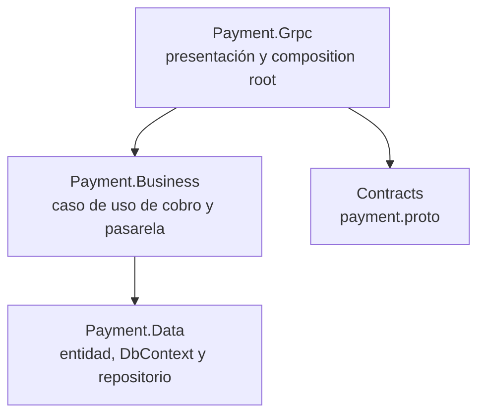
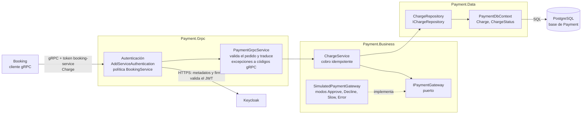
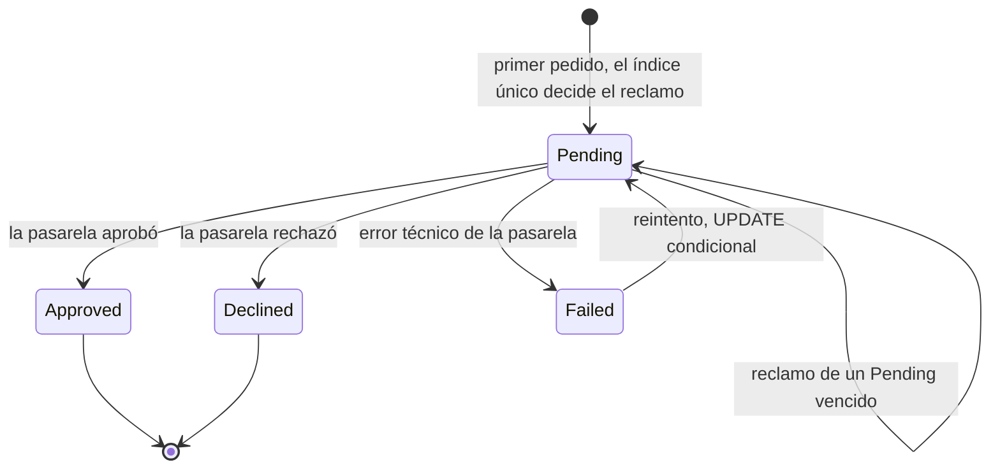

# Arquitectura de Payment (N-Layer)

Payment cobra una reserva retenida. Recibe de Booking el id de la reserva, el monto y la moneda por gRPC, y responde si el cobro quedó aprobado o rechazado. No conoce asientos, eventos ni usuarios. Está organizado en tres capas (N-Layer): `Payment.Grpc`, `Payment.Business` y `Payment.Data`. La pasarela de pago es simulada.

## Capas y regla de dependencia

La regla es **Grpc, luego Business, luego Data**. Cada flecha es una `ProjectReference` real.

- `Payment.Grpc` no referencia a `Payment.Data`: `Program.cs` solo llama a `AddPaymentBusiness`, que registra la persistencia por dentro.
- Dominio anémico: `Charge` y `ChargeStatus` son datos sin comportamiento. Las reglas (cuándo se aprueba, idempotencia, reclamo de cobros abandonados) viven en `Payment.Business`.
- El estado persistido (`ChargeStatus`) es distinto del enum del contrato gRPC, para que cambiar lo que viaja por el cable no obligue a migrar la base.

## Componentes

| Capa | Componentes reales | Responsabilidad |
| --- | --- | --- |
| `Payment.Grpc` | `PaymentGrpcService` | Valida `reservation_id` (formato `D`), monto (1 a `Charge:MaxAmountCents`) y moneda (`Charge:SupportedCurrencies`, hoy `ARS`). Lee `x-correlation-id` y lo agrega al scope de logs sin rechazar nunca el cobro por esto. Convierte excepciones en códigos gRPC. |
| `Payment.Grpc` | `Authentication/` (`AddServiceAuthentication`) | El servicio gRPC se mapea con `RequireAuthorization(BookingService)`: sin token, `UNAUTHENTICATED`. Con el token de otro cliente, `PERMISSION_DENIED`. Con `Authority` vacío rechaza todo: falla cerrado. |
| `Payment.Business` | `ChargeService` | Caso de uso idempotente por `ReservationId`: guarda el cobro como `Pending` antes de llamar a la pasarela y guarda el resultado después. |
| `Payment.Business` | `IPaymentGateway`, `SimulatedPaymentGateway` | Puerto y adaptador de la pasarela. El resultado lo elige `SimulatedGateway:Mode`, no el monto. |
| `Payment.Business` | `ChargeResult`, `ChargeInProgressException`, `ChargeMismatchException` | Un rechazo de negocio es un resultado normal; un cobro en curso o un pedido distinto del registrado se señalan con excepciones propias. |
| `Payment.Data` | `ChargeRepository`, `PaymentDbContext`, `Charge` | Persistencia con EF Core y Npgsql: tabla `charges`, índice único sobre `reservation_id` y `claimed_at` como token de concurrencia. |

## Idempotencia por `reservation_id`

Una reserva tiene como máximo un cobro:

- Un **índice único** sobre `reservation_id` en la base garantiza un solo cobro por reserva, incluso con varias réplicas.
- Antes de cobrar, `ChargeService` inserta el cobro como `Pending`. Si dos pedidos llegan juntos, el índice decide quién cobra y el otro lo resuelve como reintento.
- Un reintento de Booking con el mismo monto y moneda devuelve el resultado guardado y no genera un segundo cargo.
- Un pedido con el mismo `reservation_id` pero otro monto o moneda responde `INVALID_ARGUMENT` (no se devuelve el resultado guardado como si coincidiera).
- `claimed_at` es token de concurrencia: si un cobro lento termina después de que otro pedido lo reclamó, su resultado se descarta y no pisa el vigente.

## Estados del cobro

| Estado | Qué responde Payment a un nuevo pedido con la misma reserva |
| --- | --- |
| `Pending` reciente | `ABORTED`: hay un cobro en curso. Booking reintenta con la misma clave. |
| `Pending` vencido (más de `Charge:PendingTimeoutSeconds`, 60 s) | Se reclama de nuevo y se vuelve a cobrar. |
| `Approved` o `Declined` | Devuelve el resultado guardado, sin cobrar de nuevo. Nunca vuelve a cobrarse. |
| `Failed` | Reclama el cobro con un `UPDATE` condicional y lo intenta otra vez. Si otro pedido lo reclamó primero, `ABORTED`. |

Cómo ve Booking las respuestas de Payment:

| Respuesta de Payment | Qué hace Booking |
| --- | --- |
| `OK` + `APPROVED` | Confirma la reserva. |
| `OK` + `DECLINED` | Rechaza con `PaymentFailed`. |
| `ABORTED`, `UNAVAILABLE`, `DEADLINE_EXCEEDED` | Reintenta con la misma clave. Si se agotan, rechaza con `PaymentUnavailable` (para `ABORTED`, deriva el mensaje a dead-letter). |
| `INVALID_ARGUMENT`, `INTERNAL`, `UNKNOWN` | No reintenta. Deriva el mensaje a dead-letter para revisión manual. |

## Fuente

- `src/Payment/Payment.Grpc/Payment.Grpc.csproj`, `Payment.Business.csproj`, `Payment.Data.csproj`: grafo de `ProjectReference`.
- `src/Payment/Payment.Grpc/Program.cs`, `Services/PaymentGrpcService.cs`, `Authentication/`.
- `src/Payment/Payment.Business/ChargeService.cs`, `ChargeResults.cs`, `Gateways/`, `BusinessServiceCollectionExtensions.cs`.
- `src/Payment/Payment.Data/PaymentDbContext.cs`, `Entities/Charge.cs`, `Entities/ChargeStatus.cs`, `Repositories/IChargeRepository.cs`.
- `src/Contracts/Protos/payment.proto`.
- `docs/contracts/payment.md`: contrato, estados, idempotencia y tabla de respuestas.
- `docs/11-Autenticacion-entre-servicios.md`: validación del token en Payment.
- `src/Payment/README.md`.
