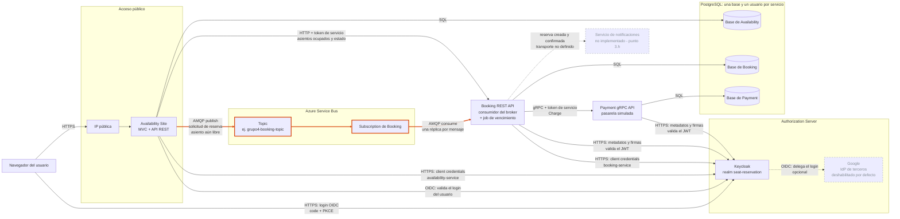

# Arquitectura del sistema

Este diagrama muestra los componentes desplegables del sistema de reservas de asientos, cómo se comunican y en qué punto el sistema deja de ser consistente de inmediato (punto 3.g del enunciado). Incluye el servicio de notificaciones del punto 3.h, que **no está implementado**: solo figura en el diagrama.

## Diagrama

Leyenda:

- Línea gruesa naranja: tramo asíncrono donde el sistema es eventualmente consistente (ver la sección siguiente).
- Línea o caja punteada: componente no implementado (notificaciones) u opcional y deshabilitado por defecto (Google).
- Los tres servicios nunca se llaman entre sí por código compartido: solo comparten el proyecto `Contracts` (mensaje del broker y `.proto` de Payment).

## Qué hace cada conexión

| Origen | Destino | Protocolo | Propósito |
| --- | --- | --- | --- |
| Navegador | Availability (por la IP pública) | HTTPS | Mapa de asientos público, solicitud de reserva y página de estado. |
| Navegador y Availability | Keycloak | HTTPS, OIDC (authorization code + PKCE) | Login del usuario con el client público `availability-web`. Después Availability trabaja con una cookie de sesión. |
| Availability | Azure Service Bus | AMQP (publish) | Publica `ReservationRequestMessage` en el topic. |
| Azure Service Bus | Booking | AMQP (consume) | Cada mensaje de la subscription lo procesa una sola réplica de Booking, con liquidación manual (complete o dead-letter). |
| Availability | Booking | HTTP + token de servicio | `GET /api/events/{eventId}/occupied-seats` y `GET /api/reservations/{requestId}/status`. |
| Booking | Payment | gRPC + token de servicio | `PaymentService.Charge` con `reservation_id` como clave de idempotencia. |
| Availability y Booking | Keycloak | HTTPS, client credentials | Piden su token de servicio (`availability-service`, `booking-service`). |
| Booking y Payment | Keycloak | HTTPS | Descargan los metadatos y las claves para validar el JWT entrante (audiencia y `azp`). |
| Keycloak | Google | OIDC | Proveedor de identidad de terceros. El realm lo importa deshabilitado: se activa a mano en la consola de Keycloak. |
| Cada servicio | Su base PostgreSQL | SQL (Npgsql / EF Core) | Persistencia propia. En Docker Compose es un solo contenedor con tres bases lógicas, cada una con su usuario. |
| Booking | Servicio de notificaciones | no definido | Avisaría que la reserva fue creada y confirmada. No existe: ver más abajo. |

## Servicio de notificaciones (punto 3.h): no implementado

El enunciado exige mostrarlo en la arquitectura, pero el equipo confirmó con el profesor que no se implementa (ticket #23 cerrado como "not planned"). Por eso:

- Está dibujado punteado y con la etiqueta "no implementado".
- No existe ninguna subscription ni consumidor para él en el broker, ni código en el repositorio.
- La conexión desde Booking es una propuesta de diseño: informaría cuando la reserva queda retenida (creada) y cuando queda confirmada tras el pago. El transporte concreto (por ejemplo un segundo topic) no se definió.

## Dónde el sistema es eventualmente consistente (punto 3.g)

> [!IMPORTANT]
> **El punto de consistencia eventual es el tramo asíncrono Availability, broker, Booking** (las flechas naranjas). Availability responde "solicitud recibida" (HTTP 202 en la API, 303 hacia la página "recibida" en el sitio MVC) apenas guardó la solicitud y publicó el mensaje, sin esperar a Booking. Entre ese momento y el instante en que Booking procesa el mensaje, **el asiento sigue figurando libre** en el mapa.

**Qué datos son eventualmente consistentes**

- La ocupación de un asiento: Availability no guarda ocupación, se la pide a Booking en cada visita al mapa. Mientras el mensaje está en el broker o sin procesar, Booking todavía no tiene la reserva y el asiento aparece libre.
- El estado de la solicitud: Availability guarda la solicitud (`reservation_requests`) pero no su estado. Lo consulta en Booking, y mientras Booking no registró nada responde 404, que Availability interpreta como "procesando".
- Availability no verifica la ocupación al aceptar la solicitud: solo comprueba que el asiento exista en el evento. Dos usuarios pueden recibir "solicitud recibida" para el mismo asiento.

**Lo que ve el usuario mientras tanto**

La página de estado (`/reservas/{requestId}/estado`) consulta cada 3 segundos, hasta 2 minutos (configurable), y muestra:

| Estado | Qué significa |
| --- | --- |
| Procesando | Booking todavía no registró la solicitud (404 de Booking). |
| Retenida | Booking retuvo el asiento (10 minutos por defecto) y el pago está en curso. |
| Confirmada | El pago fue aprobado. |
| Rechazada | Con motivo: asiento ocupado, pago rechazado o servicio de pagos no disponible. |
| Vencida | Venció la retención sin resultado de pago. |

Si Booking no responde, la página lo dice como "Booking no disponible" y no lo confunde con un rechazo.

**Cómo se resuelven los conflictos**

La decisión se toma en un solo lugar y es fuerte (no eventual): el **índice único parcial** de la base de Booking sobre `(event_id, seat_id)`, que solo cubre reservas `Retained` y `Confirmed`. Aunque haya varias réplicas de Booking consumiendo, PostgreSQL deja pasar un solo insert por asiento. El que gana queda `Retained` y sigue al cobro; el que pierde se persiste como `Rejected` con motivo `SeatTaken`, sin pasar por Payment. Reentregas del mismo mensaje son idempotentes porque el id de la solicitud es el id de la reserva.

## Fuente

- `README.md`: sección "Interpretación de componentes" y descripción de servicios (notificaciones fuera de alcance).
- `docker-compose.yml`: un contenedor PostgreSQL, Keycloak y RabbitMQ como perfil de respaldo.
- `infra/keycloak/README.md`: clients, flujos e IdP de Google.
- `docs/11-Autenticacion-entre-servicios.md` y `docs/14-autenticacion-usuarios-availability.md`: tokens de servicio y login OIDC.
- `docs/contracts/` (`reservation-request.md`, `reservation-status.md`, `occupied-seats.md`, `payment.md`): contratos entre servicios.
- `docs/booking/consumer.md`: consumidor, retención de 10 minutos e índice único parcial.
- `docs/availability-15.md`: publicación en el topic y pantalla "solicitud recibida".
- `src/Availability/Availability.Web/Program.cs`, `src/Availability/Availability.Infrastructure/DependencyInjection.cs`.
- `src/Availability/Availability.Application/ReservationRequests/ReservationRequestHandler.cs` y `ReservationStatusHandler.cs`.
- `src/Availability/Availability.Web/Controllers/ReservationStatusController.cs` y `Views/ReservationStatus/Index.cshtml`.
- `src/Booking/Booking.Api/Program.cs`, `src/Booking/Booking.Data/Configurations/ReservationConfiguration.cs`.
- `src/Payment/Payment.Grpc/Program.cs`.
