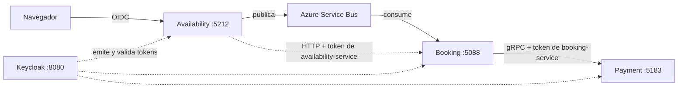

# Correr todo el sistema en local

Guía para levantar Availability, Booking, Payment, Keycloak y PostgreSQL en tu máquina, **con la autenticación entre servicios activada**, que es como corre el sistema real. Está basada en la prueba de punta a punta del 2026-11-05 (Azure Service Bus real, Keycloak, Booking y Payment reales).

Desde #51, Payment y Booking **fallan cerrado**: sin `Authority` configurada rechazan todo (Payment responde `UNAUTHENTICATED`) y Booking no puede obtener su token para cobrar. Por eso hay que levantar Keycloak y pasarles su configuración; no alcanza con arrancar los proyectos.



## 1. Requisitos

- .NET SDK 10 (versión de `global.json`) y Docker Desktop encendido.
- Puertos libres: 8080 (Keycloak), 5432 (PostgreSQL, o el que pongas en `POSTGRES_PORT`), 5183 (Payment), 5088 (Booking) y 5212 (Availability). El realm solo acepta el login desde el puerto 5212.
- Desde la raíz del repositorio: `dotnet tool restore` (instala `dotnet-ef`) y `dotnet build TpFinal.sln` (restaura los paquetes y compila; `dotnet ef` no restaura y sin este paso falla con `NETSDK1004`).
- Una cadena de conexión de Azure Service Bus (topic y suscripción de la cátedra). Si no la tenés, los tres servicios corren igual, pero Availability solo loguea el mensaje y Booking no consume: no hay flujo de punta a punta.

## 2. Variables del `.env`

Creá tu `.env` a partir de la plantilla (`cp .env.example .env`; en PowerShell, `Copy-Item .env.example .env`). Está ignorado por Git: no lo subas. Estas variables son obligatorias:

- Las cinco de Keycloak (`KEYCLOAK_ADMIN`, `KEYCLOAK_ADMIN_PASSWORD` y los tres `KEYCLOAK_*_CLIENT_SECRET`): si falta alguna, **cualquier** comando `docker compose` aborta con `set KEYCLOAK_... in .env`.
- Las nueve de las bases (`*_DB_NAME/USER/PASSWORD`): Compose solo avisa (`variable is not set`), pero el script de inicialización de PostgreSQL aborta y el contenedor `postgres-db` no arranca. Corren una sola vez, con el volumen vacío: si después las cambiás, recreá el volumen (`docker compose down -v`).

El resto (`POSTGRES_ADMIN_*`, RabbitMQ y Google) tiene valores por defecto o puede quedar vacío para esta guía.

| Variable | Para qué |
|---|---|
| `KEYCLOAK_ADMIN`, `KEYCLOAK_ADMIN_PASSWORD` | Administrador de Keycloak. |
| `KEYCLOAK_AVAILABILITY_CLIENT_SECRET`, `KEYCLOAK_BOOKING_CLIENT_SECRET`, `KEYCLOAK_PAYMENT_CLIENT_SECRET` | Secretos de los clients de servicio. El realm los toma de acá al importarse. |
| `AVAILABILITY_DB_NAME/USER/PASSWORD`, `BOOKING_DB_NAME/USER/PASSWORD`, `PAYMENT_DB_NAME/USER/PASSWORD` | Una base y un usuario por servicio. |
| `POSTGRES_PORT` | Puerto local de PostgreSQL (por defecto 5432; cambialo si está ocupado). |
| `KEYCLOAK_PORT` | Puerto local de Keycloak (por defecto 8080). |
| `GOOGLE_CLIENT_ID`, `GOOGLE_CLIENT_SECRET` | Solo para el login con Google; pueden quedar vacías. |

Los valores son tuyos (para desarrollo local sirven valores cualquiera). Lo importante: **el secreto de cada client que pongas acá es el mismo que le pasás al servicio como `ServiceCredentials__ClientSecret`** (sección 5).

## 3. Infraestructura

```bash
docker compose up -d postgres-db keycloak
```

Keycloak importa el realm `seat-reservation` **solo cuando está vacío**. Si ya tenías el volumen de una versión anterior (por ejemplo, sin nombre y apellido en `user1` y `user2`, o con otros secretos), recrealo:

```bash
docker compose down -v
docker compose up -d postgres-db keycloak
```

Keycloak queda en `http://localhost:8080` (consola de administración con `KEYCLOAK_ADMIN`). Usuarios de ejemplo para el login: `user1` y `user2`, contraseña `User123!`.

## 4. Bases de datos

Aplicá las migraciones de cada servicio. Cada una necesita su cadena de conexión en la variable `ConnectionStrings__<Servicio>` (`Availability`, `Booking`, `Payment`), con el formato `Host=localhost;Port=<POSTGRES_PORT>;Database=<DB_NAME>;Username=<DB_USER>;Password=<DB_PASSWORD>`. Por ejemplo, en Git Bash (`export ConnectionStrings__Booking="..."`) o en PowerShell (`$env:ConnectionStrings__Booking = "..."`); repetí para los otros dos servicios:

```bash
dotnet ef database update --project src/Availability/Availability.Infrastructure
dotnet ef database update --project src/Booking/Booking.Data --startup-project src/Booking/Booking.Api
dotnet ef database update --project src/Payment/Payment.Data --startup-project src/Payment/Payment.Grpc
```

Cargá el catálogo de demo de Availability (2 eventos y 20 asientos por evento; se puede repetir sin duplicar). El comando corre `psql` dentro del servicio `postgres-db` de Compose, así que no depende del nombre del contenedor; ejecutalo desde la raíz del repositorio, con `.env` completo.

Git Bash o cualquier shell POSIX:

```bash
docker compose exec -T postgres-db sh -c 'PGPASSWORD="$AVAILABILITY_DB_PASSWORD" exec psql -h 127.0.0.1 -U "$AVAILABILITY_DB_USER" -d "$AVAILABILITY_DB_NAME" -v ON_ERROR_STOP=1' < src/Availability/Availability.Infrastructure/Persistence/Scripts/demo-data.sql
```

PowerShell (no soporta `<`; hay que pasar el archivo por la tubería y con `-Encoding UTF8`, o los acentos de los nombres se guardan rotos):

```powershell
Get-Content -Encoding UTF8 src/Availability/Availability.Infrastructure/Persistence/Scripts/demo-data.sql | docker compose exec -T postgres-db sh -c 'PGPASSWORD="$AVAILABILITY_DB_PASSWORD" exec psql -h 127.0.0.1 -U "$AVAILABILITY_DB_USER" -d "$AVAILABILITY_DB_NAME" -v ON_ERROR_STOP=1'
```

Debe imprimir `INSERT 0 2` y `INSERT 0 40` la primera vez, y `INSERT 0 0` dos veces las siguientes.

## 5. Los tres servicios

Corré cada uno en su propia terminal, con `ASPNETCORE_ENVIRONMENT=Development`, desde la raíz del repositorio. Las variables van como variables de entorno o con `dotnet user-secrets` (nunca en un archivo versionado). La notación `A__B` equivale a `A:B`.

```bash
dotnet run --project src/Payment/Payment.Grpc --launch-profile http
dotnet run --project src/Booking/Booking.Api --launch-profile http
dotnet run --project src/Availability/Availability.Web --launch-profile http
```

### Payment (gRPC, puerto 5183)

| Variable | Valor |
|---|---|
| `ConnectionStrings__Payment` | Cadena de la base de Payment. |
| `Authentication__Authority` | `http://localhost:8080/realms/seat-reservation` |
| `Authentication__RequireHttpsMetadata` | `false` (solo en local, Keycloak sin HTTPS). |
| `SimulatedGateway__Mode` | Opcional: `Approve` (defecto), `Decline`, `Slow` o `Error`, para probar los caminos de fallo. |

### Booking (REST + consumer, puerto 5088)

| Variable | Valor |
|---|---|
| `ConnectionStrings__Booking` | Cadena de la base de Booking. |
| `Authentication__Authority` | `http://localhost:8080/realms/seat-reservation` (valida los tokens de `availability-service`). |
| `Authentication__RequireHttpsMetadata` | `false` (solo en local). |
| `Payment__Enabled` | `true` para cobrar de verdad. Con `false` (defecto) Booking arranca pero no cobra. |
| `Payment__Address` | `http://localhost:5183` |
| `ServiceCredentials__Authority` | `http://localhost:8080/realms/seat-reservation` |
| `ServiceCredentials__ClientId` | `booking-service` (ya es el defecto). |
| `ServiceCredentials__ClientSecret` | El valor de `KEYCLOAK_BOOKING_CLIENT_SECRET`. |
| `Broker__Provider` | `AzureServiceBus` |
| `Broker__AzureServiceBus__Enabled` | `true` para consumir del broker. |
| `Broker__AzureServiceBus__TopicName`, `__SubscriptionName` | El topic y la suscripción de la cátedra. |
| `Broker__AzureServiceBus__ConnectionString` | La cadena de conexión (secreto: `user-secrets` o variable de entorno). |

### Availability (MVC, puerto 5212)

El puerto 5212 no es casual: es el que el realm tiene como URI de redirección del login OIDC.

| Variable | Valor |
|---|---|
| `ConnectionStrings__Availability` | Cadena de la base de Availability. |
| `Keycloak__Authority` | `http://localhost:8080/realms/seat-reservation` (ya es el defecto). |
| `EventQueries__Source` | **`Database`**. En Development el defecto es `Demo`: eventos y ocupación simulados (A2 y B3 siempre ocupados), sin leer la base ni consultar a Booking. Con `Demo` la reserva no ve el estado real. |
| `DevelopmentAuthentication__Enabled` | `false` para usar el login real de Keycloak; con `true` entra un usuario fijo de desarrollo sin Keycloak. |
| `Booking__BaseUrl` | `http://localhost:5088` |
| `ServiceCredentials__Authority` | `http://localhost:8080/realms/seat-reservation` |
| `ServiceCredentials__ClientId` | `availability-service` (ya es el defecto). |
| `ServiceCredentials__ClientSecret` | El valor de `KEYCLOAK_AVAILABILITY_CLIENT_SECRET`. |
| `Broker__Provider`, `Broker__AzureServiceBus__Enabled`, `__TopicName`, `__ConnectionString` | Igual que Booking, para publicar al topic. |

## 6. Probar el flujo

1. Entrá a `http://localhost:5212`, elegí un evento y un asiento (sin el aviso "Modo demostración": si aparece, falta `EventQueries__Source=Database`).
2. Tocá "Reservar este asiento": te lleva a una página "Iniciar Sesión"; tocá "Login con Keycloak", entrá con `user1` / `User123!` y volvés al mapa con el asiento seleccionado.
3. Tocá "Reservar este asiento" otra vez: aparece "Solicitud recibida" con el id, y de ahí el estado pasa de Procesando a Retenida y Confirmada (requiere el broker; sin Azure se queda en la solicitud recibida).
4. Caminos de fallo: reservá el mismo asiento con otro usuario (queda Rechazada por asiento ocupado), poné `SimulatedGateway__Mode=Decline` en Payment (pago rechazado) o detené Payment (tres intentos y rechazada por pago no disponible).
5. Seguir una reserva por los tres servicios: ver `docs/24-logs-de-auditoria.md`.
6. Para presentar la demo (checklist, guion con tiempos y limitaciones): [demo.md](demo.md).

## 7. Reiniciar el estado entre ensayos

Las reservas confirmadas no se liberan (solo vencen las retenidas), así que después de unos ensayos los asientos se agotan. Estos scripts vacían el estado de las reservas y **conservan el catálogo** (`events` y `seats` de Availability, que carga `demo-data.sql`):

| Base | Script | Qué borra |
|---|---|---|
| Availability | `infra/scripts/reset-demo-state/availability.sql` | `reservation_requests` |
| Booking | `infra/scripts/reset-demo-state/booking.sql` | `reservations` (esto es lo que libera los asientos) |
| Payment | `infra/scripts/reset-demo-state/payment.sql` | `charges` |

Antes de correrlos:

- **Frená los servicios o asegurate de que estén inactivos** (sin reservas en curso): un mensaje que se esté procesando mientras borrás deja estados inconsistentes. Postgres y Keycloak siguen arriba.
- **No borran nada del broker.** Los mensajes que ya estén en la suscripción de Azure Service Bus siguen ahí y Booking los consumiría al arrancar, recreando reservas. Verificá que la suscripción esté vacía (mensajes activos y dead-letter en 0) en el portal de Azure, en Service Bus Explorer o en la vista general de la suscripción. Los mensajes de dead-letter son de revisión manual y no se vacían a ciegas: ver `docs/booking/payment-dlq-review.md`.
- Son solo para la demo: borran todas las filas de esas tablas.

Git Bash (desde la raíz del repositorio, con `.env` completo):

```bash
docker compose exec -T postgres-db sh -c 'PGPASSWORD="$PAYMENT_DB_PASSWORD" exec psql -h 127.0.0.1 -U "$PAYMENT_DB_USER" -d "$PAYMENT_DB_NAME" -v ON_ERROR_STOP=1' < infra/scripts/reset-demo-state/payment.sql
docker compose exec -T postgres-db sh -c 'PGPASSWORD="$BOOKING_DB_PASSWORD" exec psql -h 127.0.0.1 -U "$BOOKING_DB_USER" -d "$BOOKING_DB_NAME" -v ON_ERROR_STOP=1' < infra/scripts/reset-demo-state/booking.sql
docker compose exec -T postgres-db sh -c 'PGPASSWORD="$AVAILABILITY_DB_PASSWORD" exec psql -h 127.0.0.1 -U "$AVAILABILITY_DB_USER" -d "$AVAILABILITY_DB_NAME" -v ON_ERROR_STOP=1' < infra/scripts/reset-demo-state/availability.sql
```

PowerShell:

```powershell
Get-Content -Encoding UTF8 infra/scripts/reset-demo-state/payment.sql | docker compose exec -T postgres-db sh -c 'PGPASSWORD="$PAYMENT_DB_PASSWORD" exec psql -h 127.0.0.1 -U "$PAYMENT_DB_USER" -d "$PAYMENT_DB_NAME" -v ON_ERROR_STOP=1'
Get-Content -Encoding UTF8 infra/scripts/reset-demo-state/booking.sql | docker compose exec -T postgres-db sh -c 'PGPASSWORD="$BOOKING_DB_PASSWORD" exec psql -h 127.0.0.1 -U "$BOOKING_DB_USER" -d "$BOOKING_DB_NAME" -v ON_ERROR_STOP=1'
Get-Content -Encoding UTF8 infra/scripts/reset-demo-state/availability.sql | docker compose exec -T postgres-db sh -c 'PGPASSWORD="$AVAILABILITY_DB_PASSWORD" exec psql -h 127.0.0.1 -U "$AVAILABILITY_DB_USER" -d "$AVAILABILITY_DB_NAME" -v ON_ERROR_STOP=1'
```

Cada comando imprime `BEGIN`, `DELETE <n>` y `COMMIT`. Para comprobar que el catálogo sigue y que quedó vacío el resto:

```bash
docker compose exec -T postgres-db sh -c 'PGPASSWORD="$AVAILABILITY_DB_PASSWORD" exec psql -h 127.0.0.1 -U "$AVAILABILITY_DB_USER" -d "$AVAILABILITY_DB_NAME" -tAc "select (select count(*) from reservation_requests), (select count(*) from events), (select count(*) from seats)"'
```

Debe devolver `0|2|40`. Después, el mapa de asientos vuelve a mostrar todo libre (recargá la página). Para empezar de cero también con Keycloak y las bases: `docker compose down -v` y repetir desde la sección 3.

## 8. Problemas frecuentes

| Síntoma | Causa y solución |
|---|---|
| `dotnet ef` falla con `NETSDK1004` ("No se encuentra el archivo de recursos") | Faltó restaurar: corré `dotnet build TpFinal.sln` una vez. |
| `docker compose` dice `set KEYCLOAK_... in .env` | Falta una variable de Keycloak en el `.env` (sección 2). |
| Booking no arranca en Development con `Payment__Enabled=false` | Ya corregido en `develop` (#57). Actualizá tu rama. |
| Toda reserva termina "El servicio de pagos no estaba disponible" | Booking no puede obtener su token (revisá `ServiceCredentials__*` y que Keycloak esté arriba) o no llega a Payment (`Payment__Address`). Mirá el log de Booking: el evento 2012 trae el código. |
| Payment responde `UNAUTHENTICATED` | Payment no tiene `Authentication__Authority`, o el token de Booking no es de `booking-service`. |
| Payment responde `PERMISSION_DENIED` | El token es válido pero de otro client (Payment solo acepta `booking-service`). |
| El login de Keycloak pide completar el perfil | Tu volumen de Keycloak es anterior a #60. Recrealo con `docker compose down -v`. |
| Keycloak dice que el redirect no es válido | Corré Availability en el puerto 5212 (o 7057 con HTTPS), que son los que permite el realm. |
| Keycloak o Booking rechazan el secreto del client (401) | El `ServiceCredentials__ClientSecret` no es igual al `KEYCLOAK_*_CLIENT_SECRET` con el que se importó el realm. Si lo cambiaste, recreá el volumen. |
| El mapa dice "Modo demostración" y siempre tiene A2 y B3 ocupados | Availability corre con `EventQueries__Source=Demo` (el defecto en Development). Poné `EventQueries__Source=Database`. |
| El mapa muestra todos los asientos deshabilitados ("No podemos confirmar") | Availability no puede consultar a Booking: revisá `Booking__BaseUrl` y `ServiceCredentials__*`. |

## Fuente

- `docker-compose.yml`, `infra/keycloak/realm-export.json` y los `appsettings*.json` de los tres servicios.
- `docs/11-Autenticacion-entre-servicios.md`, `docs/14-autenticacion-usuarios-availability.md`, `docs/booking/payment-client.md`, `docs/booking/authentication.md`, `docs/availability-12.md` y `docs/availability-13.md`.
- La prueba de punta a punta del 2026-11-05.
