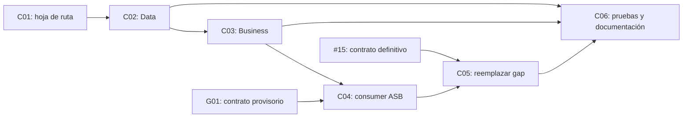

# T18 - Booking consume solicitudes de reserva

## 1. Identidad

| Campo | Valor |
|---|---|
| Issue | [#18 - Booking: consumir solicitudes de reserva](https://github.com/UTN-Progra-IV-grupo-4/tp-final-progra-iv/issues/18) |
| Rama | `18-booking-consumir-solicitudes-de-reserva` |
| Responsable | Alejandro Galarza |
| Componente | Booking |
| Arquitectura | N-Layer, dominio anémico |
| Estado general | `EN_CURSO` |

## 2. Fuentes de verdad

En caso de contradicción se utiliza este orden:

1. Enunciado original del TP.
2. Issue #18 y sus criterios de aceptación.
3. Contratos compartidos aprobados por el equipo.
4. Decisiones técnicas cerradas y README del repositorio.
5. Material conceptual de la cursada.

Clasificación utilizada en esta documentación personal:

| Estado | Criterio |
|---|---|
| `VALIDADO` | Definido por una fuente oficial o decisión cerrada. |
| `CURSO-VALIDADO` | Relacionado con las clases 01 a 12 y aprobado expresamente por Alejandro antes de incorporarlo. |
| `PROVISORIO` | No definido todavía por el TP, los tickets o el equipo; debe quedar aislado y con condición de reemplazo. |

El material de la cursada justifica conceptos y decisiones de diseño. Los detalles concretos del SDK, configuración y operación del broker no se atribuyen a las clases si estas no los especifican.

Dependencias relacionadas:

- [#4 - Decisión de message broker](https://github.com/UTN-Progra-IV-grupo-4/tp-final-progra-iv/issues/4).
- [#15 - Contrato y publicación de la solicitud](https://github.com/UTN-Progra-IV-grupo-4/tp-final-progra-iv/issues/15).
- [#17 - Estructura y persistencia de Booking](https://github.com/UTN-Progra-IV-grupo-4/tp-final-progra-iv/issues/17).
- [#20 - Vencimiento de reservas retenidas](https://github.com/UTN-Progra-IV-grupo-4/tp-final-progra-iv/issues/20).

## 3. Objetivo y alcance

Booking debe consumir solicitudes desde la suscripción `booking`, guardar una reserva `Retained` cuando el asiento esté libre y guardar una reserva `Rejected/SeatTaken` cuando esté ocupado.

También debe:

- Soportar varias réplicas de Booking.
- Ser idempotente ante entregas repetidas.
- Confirmar el mensaje solamente después de persistir el resultado.
- Registrar el inicio, fin y resultado del procesamiento sin exponer secretos.

Fuera del alcance de T18:

- Llamar a Payment y confirmar el pago: #19.
- Vencer reservas: #20.
- Exponer el endpoint de consulta: #21.
- Crear el contrato productor: #15.

## 4. Estado inicial comprobado

- La solución compila actualmente con .NET 10, 0 errores y 0 advertencias.
- Docker Desktop 4.97.0, Docker Engine 29.9.2 y Docker Compose 5.6.1 están disponibles.
- Las pruebas de integración levantan PostgreSQL 16 aislado con Testcontainers y aplican la migración inicial de Booking.
- Azure Service Bus está configurado mediante User Secrets.
- `Reservation.Id` es la clave primaria y representa el id de solicitud.
- Existe un índice único parcial sobre `(EventId, SeatId)` para `Retained` y `Confirmed`.
- La rama contiene F03 y F04 implementados, verificados, commiteados y publicados en el remoto.
- Todavía no existe el consumer de Azure Service Bus; el caso de uso, el repositorio específico y el proyecto de pruebas ya están implementados.

## 5. Decisiones técnicas

### T18-D01 - PostgreSQL arbitra la concurrencia

Estado: `VALIDADO`.

El índice único parcial será la autoridad compartida por todas las réplicas. Un `lock` en C# no sirve para coordinar procesos diferentes.

### T18-D02 - El id de solicitud garantiza idempotencia

Estado: `VALIDADO`.

`Reservation.Id` reutiliza el id enviado por Availability. Un mensaje repetido debe encontrar o colisionar con la misma clave y conservar el resultado existente.

### T18-D03 - Persistir antes de completar

Estado: `VALIDADO`.

El mensaje se completa en Azure Service Bus solamente después de guardar un resultado. Si la aplicación cae entre el guardado y el `Complete`, la reentrega se resuelve mediante idempotencia.

### T18-D04 - Azure Service Bus queda en Booking.Api

Estado: `VALIDADO`.

El broker es un adaptador de entrada. `Booking.Business` contiene el caso de uso y `Booking.Data` la persistencia; Business y Data no dependen del SDK de Azure.

### T18-D05 - La idempotencia exige identidad y payload compatibles

Estado: `VALIDADO` como regla de diseño.

Un mensaje repetido es idempotente solamente cuando conserva el mismo `RequestId`, `EventId` y `SeatId`. Si el mismo `RequestId` reaparece con otro evento o asiento, se trata como conflicto de identidad y no como duplicado exitoso; el consumer debe registrarlo y enviarlo a dead-letter.

### T18-D06 - Trazabilidad local del procesamiento

Estado: `CURSO-VALIDADO` por el responsable el 2026-10-31.

El consumer registra inicio, resultado y error con `RequestId` y, cuando exista, `CorrelationId`, sin incluir secretos. La auditoría distribuida completa permanece en #24.

### Alineación validada con las clases 01 a 12

| Decisión | Fundamento de cursada | Alcance validado |
|---|---|---|
| Capas y adaptador de entrada (`T18-D04`) | C02-P09, C06-P11 y C06-P13. | Azure Service Bus y el mapper quedan en Api; Business conserva el caso de uso y Data la persistencia. |
| Réplicas y concurrencia (`T18-D01`) | C02-P16, C03-P10 y C03-P11. | No usar locks en memoria ni estado estático; PostgreSQL e idempotencia arbitran la competencia. |
| Resiliencia (`T18-D03`) | C03-P06 y C03-P08. | Un fallo transitorio no debe producir pérdida silenciosa; la confirmación ocurre después de obtener un resultado persistido. |
| Observabilidad local (`T18-D06`) | C09-P04, C09-P05 y C09-P06. | Logs con nivel e identificadores de seguimiento, sin secretos. |

Estas cuatro relaciones fueron validadas expresamente por Alejandro el 2026-10-31. El material no define `IHostedService`, scopes de DI, `AutoCompleteMessages`, reglas exactas del mapper ni parámetros del SDK; esas decisiones permanecen provisorias.

## 6. Bloqueos y definiciones pendientes

### T18-B01 - Contrato compartido de #15

Estado: `BLOQUEADO` para cerrar la integración final, reemplazado provisoriamente por `T18-G01` durante el desarrollo.

No se debe crear un contrato paralelo. Hasta que #15 se integre, se puede desarrollar el caso de uso con un comando interno y adaptar el contrato después.

### T18-B02 - Duración de la retención

Estado: `BLOQUEADO`.

El valor está “a definir”. La duración debe ser configuración y `ExpiresAt` debe calcularse con UTC; no se debe hardcodear una decisión no acordada.

## 7. Gaps provisorios

### T18-G01 - Contrato candidato hasta que se integre #15

Estado: `PROVISORIO`.

Para avanzar se utilizará un modelo privado del adaptador de `Booking.Api`, nunca un contrato público dentro de `src/Contracts`.

Este gap queda aprobado para iniciar el desarrollo. No representa una propuesta de contrato para Availability: solamente permite deserializar un mensaje de prueba y mapearlo al comando interno estable de Business.

Contrato candidato mínimo:

```json
{
  "requestId": "00000000-0000-0000-0000-000000000000",
  "eventId": "00000000-0000-0000-0000-000000000000",
  "seatId": "00000000-0000-0000-0000-000000000000"
}
```

Metadata candidata del broker:

| Dato | Valor provisorio |
|---|---|
| `MessageId` | Igual a `requestId`. |
| `CorrelationId` | Se conserva y se propaga a logs; su regla de generación queda a confirmar. |
| `Subject` | Tipo de mensaje de solicitud de reserva; nombre exacto a confirmar. |

Puntos que #15 puede modificar:

- Nombres y casing de las propiedades JSON.
- Presencia de `requestId` dentro del cuerpo o solamente en `MessageId`.
- Nombre exacto de `Subject`.
- Regla de `CorrelationId`.
- Campos adicionales del productor.

Límite de impacto:

```text
Contrato provisorio o definitivo
             ↓
Mapper en Booking.Api
             ↓
ProcessReservationRequest de Booking.Business
```

Cuando #15 esté disponible se reemplazarán solamente el modelo de entrada y el mapper. El comando de Business, las reglas de concurrencia y Data no deben cambiar.

Condición de cierre del gap:

1. #15 está mergeado en `develop`.
2. Booking referencia el contrato compartido.
3. Se elimina el modelo provisorio.
4. Las pruebas de deserialización usan un mensaje producido con el contrato definitivo.
5. `T18-B01` y `T18-G01` pasan a `VALIDADO` y se registra la decisión final.

### T18-G02 - Diseño técnico provisorio del consumer

Estado: `PROVISORIO`.

Este gap reúne decisiones necesarias para implementar F05 y F06 que todavía no fueron definidas por el TP, los tickets o el equipo:

| Área | Definición provisoria | Cierre esperado |
|---|---|---|
| Ciclo de vida | Consumer alojado mediante `IHostedService` o `BackgroundService` en Booking.Api. | Verificar inicio, detención y cancelación; documentar el tipo finalmente usado. |
| Settlement | Procesamiento manual, inicialmente con `AutoCompleteMessages = false`. | Probar en F06 `Complete`, `DeadLetter` y reintento para cada resultado. |
| Dependencias | Un scope por mensaje; Business y Data se resuelven dentro del scope y no se comparte `DbContext`. | Confirmar lifetimes y concurrencia con pruebas. |
| Configuración | Usar `Broker:Provider` y `Broker:AzureServiceBus:{ConnectionString,TopicName,SubscriptionName}`; nunca versionar la connection string. | Ajustar si el equipo adopta otra estructura. |
| Mapper | Validar JSON, identificadores y coherencia entre `MessageId` y `requestId`; no validar todavía el nombre exacto de `Subject`. | Reemplazar las reglas dependientes del mensaje cuando cierre #15. |
| Ajustes del SDK | Concurrencia, prefetch, renovación de lock y límites de reintento sin valores definitivos. | Definir con pruebas o acuerdo del equipo. |
| Smoke test | No consumir la subscription compartida sin autorización explícita y control del mensaje de prueba. | Coordinar la prueba o usar un recurso aislado. |

F05 cubre configuración, ciclo de vida, recepción, deserialización, mapeo y delegación a Business. F06 cubre settlement, retries, dead-letter y observabilidad local. El consumer no se ejecutará contra la subscription compartida antes de completar F06.

## 8. Fases de desarrollo

| Fase | Estado | Objetivo | Criterio de salida |
|---|---|---|---|
| `T18-F00` Entorno | `VALIDADO` | Preparar .NET, Docker, PostgreSQL y secretos. | Booking arranca y consulta PostgreSQL; claves de broker presentes. |
| `T18-F01` Entendimiento | `VALIDADO` | Delimitar alcance, arquitectura, concurrencia e idempotencia. | Plan explicable y alineado con issue y TP. |
| `T18-F02` Contratos y configuración | `PROVISORIO` | Avanzar con `T18-G01` y confirmar contrato #15 y duración de retención. | El gap queda aislado; al cerrar, se usa el contrato definitivo sin afectar Business/Data. |
| `T18-F03` Data | `VALIDADO` | Implementar consultas e inserciones race-safe. | Distingue creado, duplicado y asiento ocupado. |
| `T18-F04` Business | `VALIDADO` | Implementar el caso de uso independiente del broker. | Produce `Retained`, `Rejected/SeatTaken` o idempotente. |
| `T18-F05` Consumer | `PENDIENTE` | Integrar Azure Service Bus en Booking.Api mediante `T18-G01` y `T18-G02`. | Inicia, recibe, mapea el contrato provisorio y delega a Business sin crear un contrato compartido paralelo. |
| `T18-F06` Settlement y observabilidad local | `PENDIENTE` | Completar, reintentar o dead-letter y generar logs locales. | Cada resultado tiene acción y trazabilidad explícitas; la auditoría distribuida completa queda en #24. |
| `T18-F07` Pruebas | `PENDIENTE` | Verificar casos funcionales, duplicados y concurrencia real. | Dos solicitudes simultáneas producen una retenida y una rechazada. |
| `T18-F08` Documentación y defensa | `PENDIENTE` | Documentar ejecución, diagramas y argumentos. | Otro integrante puede ejecutar y explicar la solución. |
| `T18-F09` Cierre | `PENDIENTE` | Revisar diff, compilar y preparar PR. | Checklist completo y PR hacia `develop`. |

## 9. Plan de cambios por raíz

Leyenda:

| Marca | Significado |
|---|---|
| `[A]` | Archivo o proyecto nuevo. |
| `[M]` | Archivo existente que se modifica. |
| `[P]` | Elemento provisorio asociado a un gap. |
| `[R]` | Elemento que debe reemplazarse o retirarse. |
| `[E]` | Dependencia externa producida por otro ticket. |
| `[N]` | Archivo existente que no necesita cambios. |

Árbol previsto, en orden de construcción:

```text
tp-final-progra-iv/
├── [M] TpFinal.sln
│   └── agregar Booking.Tests
│
├── src/
│   ├── Contracts/
│   │   ├── [E] contrato de solicitud generado por #15
│   │   └── [N] no crear aquí el contrato provisorio de T18-G01
│   │
│   └── Booking/
│       ├── Booking.Data/                         T18-F03
│       │   ├── [M] BookingDataServiceCollectionExtensions.cs
│       │   ├── [A] Repositories/IReservationRepository.cs
│       │   ├── [A] Repositories/ReservationRepository.cs
│       │   ├── [A] Repositories/ReservationInsertResult.cs
│       │   ├── [N] Models/Reservation.cs
│       │   ├── [N] Configurations/ReservationConfiguration.cs
│       │   └── [N] Migrations/
│       │
│       ├── Booking.Business/                     T18-F04
│       │   ├── [M] Booking.Business.csproj
│       │   ├── [M] BookingBusinessServiceCollectionExtensions.cs
│       │   └── [A] Reservations/
│       │       ├── IReservationRequestProcessor.cs
│       │       ├── ProcessReservationRequest.cs
│       │       ├── ReservationProcessingOptions.cs
│       │       ├── ReservationProcessingResult.cs
│       │       └── ReservationRequestProcessor.cs
│       │
│       └── Booking.Api/                          T18-F05 y T18-F06
│           ├── [M] Booking.Api.csproj
│           ├── [M] Program.cs
│           ├── [M] appsettings.json
│           └── [A] Messaging/
│               ├── AzureServiceBusOptions.cs
│               ├── IReservationRequestConsumer.cs
│               ├── AzureServiceBusReservationRequestConsumer.cs
│               ├── ReservationRequestMapper.cs
│               └── [A][P][R] ProvisionalReservationRequestMessage.cs
│
├── tests/
│   └── Booking/
│       └── [A] Booking.Tests/                    T18-F07
│           ├── Booking.Tests.csproj
│           ├── GlobalUsings.cs
│           ├── Data/PostgreSqlFixture.cs
│           ├── Data/ReservationRepositoryIntegrationTests.cs
│           ├── Business/ReservationRequestProcessorTests.cs
│           ├── Business/ReservationRequestProcessorIntegrationTests.cs
│           └── Messaging/[P] ReservationRequestMapperTests.cs
│
├── [N] README.md
│   └── la documentación personal no se publica como convención del equipo
└── docs/tickets/
    ├── [M] 18-booking-consumer-roadmap.md
    └── [N] TICKET-ROADMAP-TEMPLATE.md
```

### T18-C01 - Seguimiento y diseño

Estado: `EN_CURSO`.

- Agrega la plantilla y esta hoja de ruta.
- No modifica código ejecutable.
- Commit sugerido: `docs(booking): add ticket 18 development roadmap`.

### T18-C02 - Persistencia race-safe

Estado: `VALIDADO`.

- Agrega el repositorio y sus resultados explícitos.
- Registra el repositorio en DI.
- Prueba colisiones reales contra PostgreSQL.
- Distingue las restricciones `PK_reservations` e `IX_reservations_event_id_seat_id` al manejar el código PostgreSQL `23505`.
- Después de una escritura fallida, limpia el estado de seguimiento de EF Core o utiliza un contexto nuevo antes de persistir `Rejected/SeatTaken`.
- No modifica la entidad ni la migración: el esquema de #17 ya contiene las restricciones necesarias.
- Commit sugerido: `feat(booking): handle concurrent reservation creation`.

### T18-C03 - Caso de uso de Business

Estado: `VALIDADO`.

- Agrega el comando interno estable, opciones, resultado y processor.
- Business depende de la abstracción de Data, no del broker.
- Usa UTC y una duración configurable para calcular `ExpiresAt`.
- Distingue un duplicado compatible de un `RequestId` reutilizado con otro evento o asiento.
- Commit sugerido: `feat(booking): process reservation requests`.

### T18-C04 - Adaptador de Azure Service Bus

Estado: `PENDIENTE`.

- Agrega el SDK y la configuración del broker en Booking.Api.
- Agrega el ciclo de vida provisorio del consumer según `T18-G02`.
- Usa temporalmente `T18-G01` y concentra el gap en el mensaje provisorio y su mapper.
- Recibe, deserializa, mapea y delega el mensaje a Business.
- Deja para F06 la validación completa de `Complete`, `DeadLetter`, reintento y logs locales. No se ejecuta contra la subscription compartida antes de cerrar esas rutas.
- Commit sugerido: `feat(booking): consume reservation requests`.

### T18-C05 - Reemplazo por el contrato de #15

Estado: `BLOQUEADO`.

- Agrega la referencia de Booking.Api a `Contracts` cuando #15 esté en `develop`.
- Reemplaza y elimina `ProvisionalReservationRequestMessage.cs`.
- Ajusta únicamente el mapper y sus pruebas.
- Business y Data no deben cambiar.
- Puede integrarse dentro de `T18-C04` si #15 llega antes de ese commit.

### T18-C06 - Pruebas, documentación y cierre

Estado: `PENDIENTE`.

- Completa pruebas unitarias, de integración y smoke test controlado con Azure Service Bus.
- Actualiza la documentación personal, la hoja de ruta, la evidencia y la defensa oral.
- Commit sugerido: `test(booking): cover duplicate and concurrent requests`, seguido de `docs(booking): document reservation consumer flow`.

### Orden de dependencias



Regla de referencias que debe conservarse:

```text
Booking.Api ───────> Booking.Business ───────> Booking.Data
     │
     └─────────────> Contracts  (solamente después de #15)

Booking.Data nunca referencia Business o Api.
Booking.Business nunca referencia Api, Contracts o Azure Service Bus.
```

## 10. Historial real de prompts y respuestas clave

### T18-F00-P01 - Validar la nueva PC

- Fecha: 2026-10-29
- Estado: `VALIDADO`
- Prompt: “Estoy en una nueva PC; validemos si está en condiciones para resolver los tickets”.
- Respuesta clave (`T18-F00-R01`): .NET 10, NuGet y Git funcionan; la solución compila. Faltaban Docker, PostgreSQL y configuración local.
- Validaciones relacionadas: `T18-V01`.

### T18-F00-P02 - Preparar Docker y PostgreSQL

- Fecha: 2026-10-29
- Estado: `VALIDADO`
- Prompt: “Preparemos lo más importante: Docker y PostgreSQL con Docker”.
- Respuesta clave (`T18-F00-R02`): Docker Desktop y PostgreSQL 16 funcionaron durante la preparación inicial. El 2026-10-31 se revalidó Docker Engine 29.9.2 y se ejecutaron cuatro pruebas contra PostgreSQL 16 temporal con la migración real.
- Validaciones relacionadas: `T18-V01`, `T18-V02`.

### T18-F00-P03 - Configurar Azure Service Bus

- Fecha: 2026-10-29
- Estado: `VALIDADO`
- Prompt sanitizado: “Tengo la connection string completa; indicame cómo usarla para desarrollar”.
- Respuesta clave (`T18-F00-R03`): se guardaron provider, connection string, topic y subscription mediante User Secrets. Ningún secreto se incorporó al repositorio.
- Decisiones relacionadas: `T18-D04`.
- Validaciones relacionadas: `T18-V03`.

### T18-F01-P01 - Plan para entender y defender el ticket

- Fecha: 2026-10-29
- Estado: `VALIDADO`
- Prompt: “Realicemos primero el plan de desarrollo de la 18, entendimiento para que pueda defenderlo en la defensa oral”.
- Respuesta clave (`T18-F01-R01`): se definieron alcance, capas, flujo, concurrencia, idempotencia, settlement, pruebas y preguntas probables de defensa.
- Decisiones relacionadas: `T18-D01`, `T18-D02`, `T18-D03`, `T18-D04`.

### T18-F01-P02 - Crear una estructura repetible

- Fecha: 2026-10-29
- Estado: `VALIDADO`
- Prompt: “Hagamos una hoja de ruta con los prompts y respuestas claves; definamos una nomenclatura y mantengamos la misma estructura”.
- Respuesta clave (`T18-F01-R02`): se creó una plantilla común y esta hoja de ruta con fases, prompts, respuestas, decisiones, bloqueos y validaciones identificables.
- Cambios relacionados: `T18-C01`.

### T18-F01-P03 - Ordenar los cambios desde la raíz

- Fecha: 2026-10-29
- Estado: `VALIDADO`
- Prompt: “Preparemos el plan en orden con su raíz de qué se modifica y qué se agrega”.
- Respuesta clave (`T18-F01-R03`): se agregó un árbol completo del repositorio con marcas para archivos nuevos, modificados, provisorios, externos y sin cambios; también se definieron seis grupos de cambios y su orden de dependencia.
- Cambios relacionados: `T18-C01`, `T18-C02`, `T18-C03`, `T18-C04`, `T18-C05`, `T18-C06`.

### T18-F01-P04 - Validar backlog y dependencias

- Fecha: 2026-10-31
- Estado: `VALIDADO`
- Prompt: “Repasemos cada ticket y validemos si el ticket 18 está en condiciones y alineado a cómo se va a desarrollar”.
- Respuesta clave (`T18-F01-R04`): se revisaron los 25 tickets, sus criterios y dependencias. #3, #4 y #17 estaban resueltos; #15 seguía pendiente para la integración final. Se confirmó que Data y Business podían avanzar con un contrato privado provisorio.
- Decisiones relacionadas: `T18-D01`, `T18-D02`, `T18-D03`, `T18-D04`, `T18-D05`.
- Bloqueos relacionados: `T18-B01`, `T18-B02`.
- Gaps relacionados: `T18-G01`.

### T18-F02-P01 - Habilitar un contrato provisorio

- Fecha: 2026-10-29
- Estado: `VALIDADO`
- Prompt: “Provisoriamente, ¿podría dejarlo como gap o bloqueo a corregir cuando esté disponible y tener uno potencial para el 15?”.
- Respuesta clave (`T18-F02-R01`): se permite avanzar con un modelo privado y reemplazable en Booking.Api; no se crea un contrato paralelo en `src/Contracts` y Business/Data permanecen independientes.
- Bloqueos relacionados: `T18-B01`.
- Gaps relacionados: `T18-G01`.

### T18-F03-P01 - Iniciar persistencia paso a paso

- Fecha: 2026-10-31
- Estado: `VALIDADO`
- Prompt: “Comencemos, para alinearnos al desarrollo actual. Indicame paso a paso”.
- Respuesta clave (`T18-F03-R01`): se agregaron la abstracción del repositorio, los resultados `Created`, `RequestIdExists` y `SeatTaken`, el manejo de PostgreSQL `23505`, la recuperación del contexto de EF Core y el registro mediante inyección de dependencias.
- Cambios relacionados: `T18-C02`.
- Validaciones relacionadas: `T18-V01`.

### T18-F03-P02 - Definir cómo completar Data

- Fecha: 2026-10-31
- Estado: `VALIDADO`
- Prompt: “¿Cuál es el procedimiento para completar F03?”.
- Respuesta clave (`T18-F03-R02`): se definió y ejecutó una suite con xUnit, Testcontainers y PostgreSQL 16 para verificar inserción libre, RequestId existente, competencia simultánea y recuperación del contexto después de una violación única. La salida completa de Docker se trató como evidencia y no como prompt independiente.
- Cambios relacionados: `T18-C02`, `T18-C06`.
- Validaciones relacionadas: `T18-V02`, `T18-V04`, `T18-V05`, `T18-V06`.

### T18-F04-P01 - Especificar el comportamiento de Business

- Fecha: 2026-10-31
- Estado: `VALIDADO`
- Prompt: “Dame detalle y especificación de lo que debe hacer, cómo debe comportarse y el orden de cómo se debe desarrollar”.
- Respuesta clave (`T18-F04-R01`): se definieron comando, opciones, resultados, validaciones, cálculo UTC de `ExpiresAt`, duplicado idempotente, conflicto de RequestId, persistencia de `Rejected/SeatTaken`, propagación de errores y orden de implementación.
- Decisiones relacionadas: `T18-D01`, `T18-D02`, `T18-D05`.
- Cambios relacionados: `T18-C03`.

### T18-F04-P02 - Confirmar los límites del ticket

- Fecha: 2026-10-31
- Estado: `VALIDADO`
- Prompt: “¿Esto es scope del ticket 18 o afectamos a otros?”.
- Respuesta clave (`T18-F04-R02`): se confirmó que F04 pertenece a #18 y que no debía implementar responsabilidades de Availability, Payment, vencimientos, endpoint de estado, autenticación ni auditoría distribuida.
- Decisiones relacionadas: `T18-D04`.
- Cambios relacionados: `T18-C03`.

### T18-F04-P03 - Implementar Business

- Fecha: 2026-10-31
- Estado: `VALIDADO`
- Prompt: “Continuemos”.
- Contexto: continuar con la implementación de F04 según la especificación y los límites previamente validados.
- Respuesta clave (`T18-F04-R03`): se implementó `ReservationRequestProcessor`, validación de identificadores, retención configurable, idempotencia, conflicto de payload y persistencia de `Rejected/SeatTaken`. La suite finalizó con 15 pruebas correctas y la solución completa compiló con 0 advertencias y 0 errores.
- Cambios relacionados: `T18-C03`, `T18-C06`.
- Validaciones relacionadas: `T18-V01`, `T18-V04`, `T18-V05`, `T18-V06`, `T18-V10`.

### T18-F08-P01 - Crear documentación personal por especificaciones

- Fecha: 2026-10-31
- Estado: `VALIDADO`
- Prompt sanitizado: “Creemos una carpeta en docs para desarrollo por especificaciones, donde podamos explicar el proyecto y registrar lo que vayamos desarrollando para mantener la documentación alineada al código”.
- Corrección terminológica: “SDD, Spec-Driven Development”.
- Respuesta clave (`T18-F08-R01`): se creó una estructura personal con contexto, especificación del ticket, trazabilidad entre requisitos y archivos, registro de implementación y evidencia.
- Cambios relacionados: `T18-C01`, `T18-C06`.

### T18-F08-P02 - Limitar SDD al uso personal

- Fecha: 2026-10-31
- Estado: `VALIDADO`
- Prompt: “Con el equipo aún no se valida el uso de SDD; es para mi uso propio. Lo quitaría del README y dejaría la documentación con mis desarrollos”.
- Respuesta clave (`T18-F08-R02`): se eliminó la referencia del README principal y la documentación quedó limitada al seguimiento personal de Alejandro, sin establecer una metodología ni una decisión para el equipo.
- Cambios relacionados: `T18-C01`, `T18-C06`.

### T18-F08-P03 - Auditar y persistir la documentación personal

- Fecha: 2026-10-31
- Estado: `VALIDADO`
- Prompt: “Revisá toda la documentación pendiente del ticket #18. Confirmá que representa únicamente mi registro personal, que los prompts y sus contextos coinciden con las interacciones reales, que las evidencias corresponden al código implementado y que no contiene secretos ni presenta SDD como metodología aprobada por el equipo. Si todo está consistente, prepará el commit `docs(booking): registrar desarrollo del ticket 18` sin modificar código productivo”.
- Respuesta clave (`T18-F08-R03`): se auditaron los siete archivos de `docs/`, se corrigieron las referencias residuales que indicaban modificar el README principal, se contrastaron prompts, código, commits y evidencia, y se preparó un commit limitado a la documentación personal sin secretos ni cambios productivos.
- Cambios relacionados: `T18-C01`, `T18-C06`.
- Validaciones relacionadas: `T18-V01`, `T18-V02`, `T18-V04`, `T18-V05`, `T18-V06`, `T18-V10`.

### T18-F05-P01 - Clasificar especificaciones antes del consumer

- Fecha: 2026-10-31
- Estado: `VALIDADO`
- Prompt: “Actualizá la especificación personal y la hoja de ruta del ticket #18 aplicando la clasificación acordada: registrá las definiciones respaldadas por las clases 01–12 que validé y marcá expresamente como provisorias las decisiones técnicas todavía no definidas por el TP, los tickets o el equipo. Corregí el prompt de F05 para utilizar temporalmente T18-G01 mientras #15 siga pendiente. No modifiques código productivo”.
- Contexto: antes de implementar F05 se revisaron las definiciones faltantes y se separó el fundamento conceptual de la cursada de los detalles concretos del SDK y del contrato pendiente de #15.
- Respuesta clave (`T18-F05-R01`): se registraron como validadas las decisiones de capas, réplicas, resiliencia y observabilidad; se creó `T18-G02` para las decisiones técnicas provisorias; se delimitó F05 respecto de F06 y se corrigió el prompt de implementación para usar `T18-G01` mientras #15 siga pendiente.
- Decisiones relacionadas: `T18-D01`, `T18-D03`, `T18-D04`, `T18-D06`.
- Gaps relacionados: `T18-G01`, `T18-G02`.
- Cambios relacionados: documentación personal; sin cambios en código productivo.

## 11. Prompts previstos

Estos prompts son guías. Se registrarán como historial real solamente cuando se ejecuten.

### T18-F02-P02 - Resolver definitivamente las dependencias

> Revisá el estado actual de #15 y confirmá el contrato que consumirá Booking. Identificá campos, metadata, MessageId y CorrelationId. No inventes un contrato paralelo. Confirmá también la duración acordada para la retención.

Resultado esperado (`T18-F02-R02`): contrato final trazable, eliminación de `T18-G01` y duración configurable aceptada.

### T18-F05-P02 - Integrar el consumer

> Implementá F05 en Booking.Api usando las opciones ya guardadas en User Secrets y el modelo privado provisorio `T18-G01` mientras #15 siga pendiente. Leé topic y subscription desde configuración, iniciá y detené el adaptador, deserializá, mapeá y delegá el comando a Business. Mantené el tipo provisorio y su mapper aislados en Booking.Api, no agregues un contrato paralelo a `src/Contracts` y tratá las decisiones concretas del SDK conforme a `T18-G02` sin presentarlas como acuerdos del equipo. No ejecutes el consumer contra la subscription compartida antes de completar F06.

Resultado esperado (`T18-F05-R02`): adaptador que inicia y se detiene correctamente, consume la configuración, transforma `T18-G01` y delega a Business, con el gap limitado al borde de Booking.Api.

### T18-F06-P01 - Settlement y observabilidad

> Implementá y justificá Complete, DeadLetter y reintento para cada resultado. Agregá logs estructurados de inicio y fin con RequestId y CorrelationId sin registrar datos sensibles.

Resultado esperado (`T18-F06-R01`): ninguna ruta pierde mensajes silenciosamente y el flujo puede reconstruirse desde logs.

### T18-F07-P01 - Verificar aceptación

> Ejecutá las pruebas del ticket 18 contra PostgreSQL real. Demostrá solicitud nueva, duplicado, payload inconsistente, mensaje inválido y dos solicitudes simultáneas por el mismo asiento.

Resultado esperado (`T18-F07-R01`): evidencia reproducible de una reserva retenida y otra rechazada con SeatTaken, sin duplicados.

### T18-F08-P04 - Preparar defensa oral

> Generá la documentación final del ticket 18 con diagrama, instrucciones de ejecución, decisiones, tradeoffs y un simulacro de preguntas de defensa. Relacioná la solución con N-Layer, mensajería, concurrencia e idempotencia vistas en clase.

Resultado esperado (`T18-F08-R04`): explicación breve y demostración ejecutable por otro integrante.

### T18-F09-P01 - Revisión final

> Revisá el diff completo del ticket 18 contra develop. Buscá errores funcionales, secretos, violaciones de capas y pruebas faltantes. Compilá, ejecutá las pruebas y prepará la descripción del PR con Closes #18.

Resultado esperado (`T18-F09-R01`): PR revisable, sin secretos y con criterios de aceptación demostrados.

## 12. Validaciones

| ID | Estado | Evidencia |
|---|---|---|
| `T18-V01` | `VALIDADO` | `dotnet build TpFinal.sln`: 0 errores y 0 advertencias. |
| `T18-V02` | `VALIDADO` | Testcontainers levantó PostgreSQL 16, aplicó la migración y ejecutó las pruebas de repositorio. |
| `T18-V03` | `VALIDADO` | User Secrets contiene las cinco claves esperadas, verificadas sin publicar valores. |
| `T18-V04` | `VALIDADO` | El repositorio crea una solicitud nueva como `Retained`. |
| `T18-V05` | `VALIDADO` | Un RequestId duplicado devuelve la reserva existente y conserva una única fila. |
| `T18-V06` | `VALIDADO` | Dos processors simultáneos dejaron una reserva `Retained` y otra `Rejected/SeatTaken` en PostgreSQL. |
| `T18-V07` | `PENDIENTE` | Error transitorio no completa el mensaje. |
| `T18-V08` | `PENDIENTE` | Mensaje inválido va a dead-letter. |
| `T18-V09` | `PENDIENTE` | El modelo provisorio se reemplaza por #15 sin cambiar Business/Data. |
| `T18-V10` | `PARCIAL` | Business devuelve `RequestConflict` para otro EventId o SeatId; el envío a dead-letter se validará en F06. |

## 13. Guion de defensa oral

La explicación debe seguir siempre este orden:

1. Problema: varias personas y réplicas pueden competir por el mismo asiento.
2. Entrada: Availability publica y Booking consume asincrónicamente.
3. Capas: Api adapta el broker, Business decide y Data persiste.
4. Concurrencia: PostgreSQL arbitra mediante el índice único parcial.
5. Idempotencia: el RequestId es la clave primaria.
6. Confiabilidad: se persiste antes de completar el mensaje.
7. Consistencia eventual: Availability responde antes de que Booking termine.
8. Evidencia: pruebas concurrentes, logs y estado final de la base.

## 14. Definición de terminado de T18

- Consumer compatible con múltiples réplicas.
- Contrato compartido de #15 utilizado sin duplicación.
- Una solicitud libre crea `Retained` con `ExpiresAt`.
- Una disputa concurrente produce `SeatTaken` para el perdedor.
- Un duplicado no genera una segunda reserva.
- Un RequestId reutilizado con otro evento o asiento se detecta como conflicto y no se trata como idempotencia válida.
- Mensajes correctos se completan solo después de persistir.
- Errores transitorios se reintentan y mensajes inválidos van a dead-letter.
- Logs estructurados permiten seguir inicio y fin.
- Pruebas y comandos están documentados.
- No hay secretos versionados.
- El responsable puede defender decisiones y tradeoffs.
- `T18-G01` fue eliminado y no queda ningún contrato provisorio en producción.
