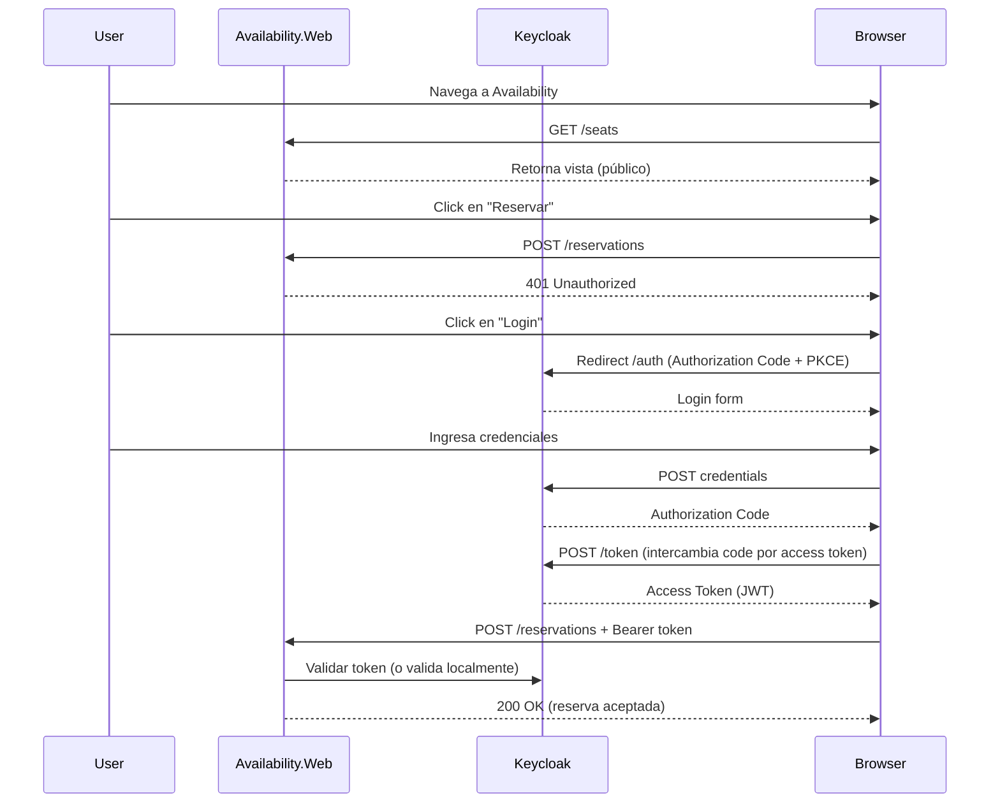
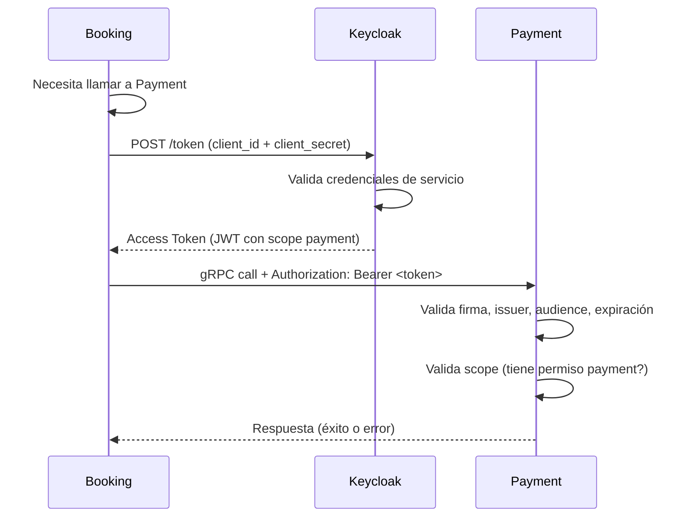

# Keycloak - Authorization Server

## Descripción

Keycloak es el servidor de autorización del sistema de reserva de asientos. Gestiona la autenticación de usuarios y la autorización entre microservicios utilizando los protocolos OpenID Connect (OIDC) y OAuth 2.0.

## Tecnologías

- **Keycloak 26.0.7**: Servidor de identidad y acceso open source
- **OpenID Connect (OIDC)**: Protocolo de autenticación para usuarios
- **OAuth 2.0 Client Credentials**: Flujo de autenticación entre microservicios
- **Docker**: Ejecución en contenedor para reproducibilidad

## Estructura de carpetas

```
infra/keycloak/
├── realm-export.json          # Configuración exportada del realm
├── import-realm.sh            # Script para importar el realm manualmente
└── README.md                  # Esta documentación
```

## Configuración del Realm

### Realm: `seat-reservation`

El realm `seat-reservation` contiene toda la configuración de autenticación y autorización del sistema.

### Clients

| Client | Tipo | Flujo | Purpose | Audience Mapper |
|--------|------|-------|---------|-----------------|
| `availability-web` | Public | Authorization Code + PKCE | Autenticación de usuarios en Availability.Web | No aplica |
| `booking-service` | Confidential | Client Credentials | Booking obtiene tokens para llamar a Payment | `payment-service` (incluye audience de Payment en el token) |
| `payment-service` | Confidential | Validación de tokens | Payment valida tokens de Booking | No aplica (solo valida) |

**Nota importante:** El client `booking-service` tiene un audience mapper configurado para incluir `payment-service` en el claim `aud` del token. Esto permite que Booking obtenga un token válido para llamar a Payment usando el flujo Client Credentials.

### Usuarios de prueba

| Username | Password | Roles | Purpose |
|----------|----------|-------|---------|
| `user1` | `User123!` | `user` | Usuario regular para reservas |
| `user2` | `User123!` | `user` | Segundo usuario para testing de concurrencia |
| `admin` | `Admin123!` | `admin`, `user` | Usuario administrativo |

### Roles

- `user`: Rol estándar para usuarios regulares
- `admin`: Rol con permisos elevados (futuro uso)

## Flujo de autenticación de usuarios



## Flujo de autenticación entre microservicios (Client Credentials)



## Configuración de variables de entorno

Crear un archivo `.env` en la raíz del proyecto:

```bash
# Keycloak
KEYCLOAK_ADMIN=admin
KEYCLOAK_ADMIN_PASSWORD=admin
KEYCLOAK_PORT=8080
KEYCLOAK_REALM=seat-reservation
KEYCLOAK_ISSUER=http://localhost:8080/realms/seat-reservation
KEYCLOAK_FRONTEND_CLIENT_ID=availability-web
KEYCLOAK_BOOKING_CLIENT_ID=booking-service
KEYCLOAK_BOOKING_CLIENT_SECRET=booking-service-secret-change-in-production
KEYCLOAK_PAYMENT_CLIENT_ID=payment-service
KEYCLOAK_PAYMENT_CLIENT_SECRET=payment-service-secret-change-in-production
```

**⚠️ IMPORTANTE**: Los valores `*_SECRET` deben cambiarse en producción. Nunca comitar el archivo `.env` real.

## Instrucciones para ejecutar el servicio

### 1. Configurar variables de entorno

```bash
cp .env.example .env
# Editar .env con tus valores (o usar los defaults para desarrollo)
```

### 2. Levantar Keycloak con Docker Compose

```bash
docker-compose up keycloak
```

O para levantar todos los servicios:

```bash
docker-compose up
```

### 3. Verificar que Keycloak está funcionando

```bash
curl http://localhost:8080/health/ready
```

Debería retornar `{"status":"UP"}`.

### 4. Acceder a la consola de administración

- URL: http://localhost:8080/admin
- Usuario: `admin`
- Contraseña: `admin` (o la configurada en `.env`)

### 5. Importar realm manualmente (si falla la importación automática)

```bash
# Dentro del contenedor
docker exec -it keycloak bash
cd /opt/keycloak/data/import
bash import-realm.sh
```

## Auditoría

Keycloak registra automáticamente:

- Intentos de login exitosos y fallidos
- Emisión de tokens
- Errores de autenticación
- Errores de autorización

Los logs están disponibles en:

```bash
docker logs keycloak
```

## Endpoints importantes

| Endpoint | Purpose |
|----------|---------|
| `http://localhost:8080/health/ready` | Health check |
| `http://localhost:8080/realms/seat-reservation/.well-known/openid-configuration` | Discovery endpoint OIDC |
| `http://localhost:8080/realms/seat-reservation/protocol/openid-connect/token` | Token endpoint |
| `http://localhost:8080/realms/seat-reservation/protocol/openid-connect/auth` | Authorization endpoint |
| `http://localhost:8080/admin` | Consola de administración |

## Exportar/Importar Realm

### Exportar realm actual

```bash
# Desde la consola de Keycloak Admin
# Realm Settings -> Export -> Download JSON
```

### Importar realm manualmente

```bash
# Via API Admin
curl -X POST http://localhost:8080/admin/realms \
  -H "Authorization: Bearer <admin-token>" \
  -H "Content-Type: application/json" \
  -d @infra/keycloak/realm-export.json
```

## Justificación de decisiones arquitectónicas

### ¿Por qué Keycloak en Docker?

- **Reproducibilidad**: Cualquier miembro del equipo obtiene la misma configuración con `docker-compose up`
- **Independencia de servicios externos**: Funciona sin internet y sin depender de permisos de Azure
- **Costo cero**: Open source y gratuito
- **Cumple requisitos del TP**: Validado por el profesor como contenedor virtualizado

### ¿Por qué Authorization Code + PKCE para usuarios?

- **Seguridad**: PKCE previene ataques de authorization code interception
- **Compatible con SPAs**: Funciona bien con aplicaciones web modernas
- **Estándar**: Recomendado por OAuth 2.1 para clientes públicos

### ¿Por qué Client Credentials para microservicios?

- **Separación de concernes**: Los servicios tienen su propia identidad, no reutilizan tokens de usuarios
- **Seguridad**: Los secretos son confidenciales y pueden rotarse
- **Requisito del TP**: Especificado por el profesor

## Troubleshooting

### Keycloak no arranca

```bash
# Ver logs
docker logs keycloak

# Verificar puerto no está en uso
netstat -an | grep 8080
```

### Importación automática falla

- Usar el script `import-realm.sh` manualmente
- Verificar que el archivo `realm-export.json` tiene formato JSON válido
- Asegurarse de que Keycloak esté completamente iniciado antes de importar

### Token validation falla en microservicios

- Verificar que `KEYCLOAK_ISSUER` sea correcto
- Verificar que el token no esté expirado
- Verificar que el audience sea correcto
- Verificar que el client secret coincida

## Referencias

- [Keycloak Documentation](https://www.keycloak.org/documentation)
- [OpenID Connect Specification](https://openid.net/connect/)
- [OAuth 2.0 Client Credentials](https://oauth.net/2/grant-types/client-credentials/)
- [Issue #5 - Decisión: servidor de autorización](https://github.com/UTN-Progra-IV-grupo-4/tp-final-progra-iv/issues/5)
