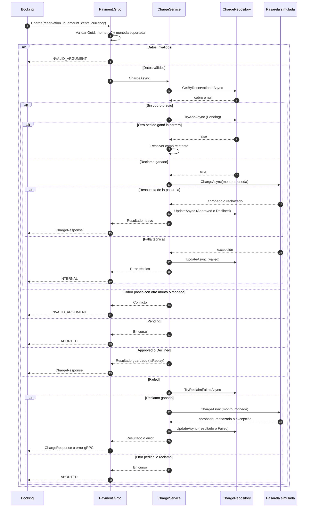

# Contrato Booking → Payment

> Estado: borrador para el PR de #22. Fuente de verdad del `.proto`: `src/Contracts/Protos/payment.proto`.
> Este documento describe el contrato y las reglas de negocio. El detalle de implementación vive en el código de `Payment.Business`.

## 1. Propósito

Payment cobra una reserva retenida. Recibe el id de la reserva, el monto y la moneda, y responde si el cobro quedó aprobado o rechazado. Payment no conoce asientos, eventos ni usuarios: solo cobra.

Payment es el único servicio que escribe en su base. Booking no lee la base de Payment.

## 2. Contrato RPC

```proto
service PaymentService {
  rpc Charge (ChargeRequest) returns (ChargeResponse);
}
```

| Campo | Tipo | Regla |
|---|---|---|
| `reservation_id` | string (Guid) | Obligatorio. Es la clave de idempotencia: una reserva tiene como máximo un cobro. |
| `amount_cents` | int64 | Mayor que 0. Monto fijo por asiento, en centavos enteros. Lo configura Booking en `Payment:AmountCents`. |
| `currency` | string | Código ISO 4217 de 3 letras mayúsculas. Por ahora solo se acepta `ARS`. La lista la configura Payment en `SupportedCurrencies`. |

Respuesta `ChargeResponse`:

| Campo | Tipo | Regla |
|---|---|---|
| `status` | `ChargeStatus` | `APPROVED` o `DECLINED`. `UNSPECIFIED` nunca se devuelve. |
| `charge_id` | string | Id del cobro en Payment, para trazabilidad. |
| `failure_reason` | string | Solo si `status` es `DECLINED`. |

Un rechazo de negocio viaja en la respuesta. Un error técnico viaja como código de estado gRPC.

## 3. Códigos de respuesta y cómo los interpreta Booking

| Respuesta de Payment | Significado | Qué hace Booking |
|---|---|---|
| `OK` + `APPROVED` | Cobro aprobado | Confirma la reserva. |
| `OK` + `DECLINED` | Rechazo de negocio | Rechaza con motivo `PaymentFailed`. |
| `ABORTED` | Hay un cobro en curso para esta reserva (`Pending`) | Reintenta con la misma clave, sin cobrar de nuevo. |
| `UNAVAILABLE` | Payment no responde | Reintenta. Si se agotan los reintentos, rechaza con `PaymentUnavailable` y registra "posible cobro tardío, resultado desconocido". |
| `DEADLINE_EXCEEDED` | Payment no respondió dentro del deadline de Booking | Igual que `UNAVAILABLE`. |
| `INTERNAL` | Error técnico de la pasarela. El cobro quedó en `Failed` | Igual que `UNAVAILABLE`. Pendiente de confirmar en #19. |
| `INVALID_ARGUMENT` | Datos inválidos, moneda no soportada o mismo `reservation_id` con otro monto o moneda | Error de configuración o de implementación. No rechaza la reserva automáticamente. Pendiente de definir en #19. |
| `UNAUTHENTICATED` / `PERMISSION_DENIED` | Token inválido o sin el rol necesario | Error de configuración. Autenticación definida en #11. |

## 4. Estados del cobro

| Estado | Significado | Qué responde Payment a un nuevo pedido con la misma reserva |
|---|---|---|
| `Pending` | El cobro está reclamado y la pasarela todavía no respondió | `ABORTED` |
| `Approved` | La pasarela aprobó el cobro | Resultado guardado, sin cobrar de nuevo |
| `Declined` | La pasarela rechazó el cobro (fondos, tarjeta) | Resultado guardado, sin cobrar de nuevo |
| `Failed` | Error técnico. En la simulación no hubo cargo | Reclama el cobro con un `UPDATE` condicional y lo intenta de nuevo. Si otro pedido lo reclamó primero, responde `ABORTED`. |

Transiciones:

```
(sin cobro) → Pending → Approved
                     → Declined
                     → Failed → Pending   (reintento)
```

Un cobro `Approved` o `Declined` nunca vuelve a cobrarse. Un cobro `Failed` puede reintentarse, pero solo si nadie lo tiene reclamado.

## 5. Reglas de idempotencia

- Una reserva tiene como máximo un cobro. Lo garantiza un índice único sobre `ReservationId` en la base.
- Antes de cobrar, el cobro se guarda como `Pending`. Así dos pedidos simultáneos no cobran dos veces: el índice único decide quién gana.
- Si un pedido llega con el mismo `reservation_id` pero con otro monto o moneda, responde `INVALID_ARGUMENT`. No se devuelve el resultado guardado como si coincidiera.
- Un reintento de Booking tras perder la respuesta devuelve el resultado guardado y no genera un segundo cargo.

## 6. Reglas de negocio

| Regla | Quién la decide | Detalle |
|---|---|---|
| Un asiento por solicitud | Issue #22 | Una reserva, un cobro. No hay cantidad. |
| Precio fijo por asiento | Issue #22 | `Payment:AmountCents` en Booking. Availability no conoce el precio. |
| Solo ARS por ahora | Issue #22 | Ampliable con `SupportedCurrencies` sin cambiar el contrato. |
| `Failed` significa que no hubo cargo | Issue #22 | Vale para la pasarela simulada. Con una pasarela real, un timeout no lo garantiza. |
| No hay reembolso automático | Issue #22 | Un cobro aprobado para una reserva ya vencida o rechazada se resuelve manualmente. |
| Cotejo manual | Issue #22 | Lo hace Payment consultando la tabla de cobros por `reservation_id`. Booking no consulta la base de Payment. |
| No hay RPC de consulta ni de reembolso | Issue #22 | Se evita agregar superficie al contrato en esta etapa. |

### Procedimiento de cotejo

1. Booking registra "posible cobro tardío, resultado desconocido" cuando agota los reintentos con `UNAVAILABLE`, `DEADLINE_EXCEEDED` o `ABORTED`.
2. El responsable de Payment consulta la tabla de cobros por `reservation_id`.
3. Si el cobro está `Approved` y la reserva está `Rejected` o `Expired`, se inicia el reembolso manual y se registra el caso.
4. Si el cobro está `Failed` o `Pending`, no hay cargo que revertir.

## 7. Modos de la pasarela simulada

Se elige con `SimulatedGateway:Mode` por variable de entorno, sin depender del monto.

| Modo | Comportamiento | Para qué sirve en la demo |
|---|---|---|
| `Approve` | Cobro aprobado | Happy path |
| `Decline` | Rechazo por fondos insuficientes | Pago fallido |
| `Slow` | Demora `SlowDelaySeconds` (15 s) y luego aprueba | Timeout de Booking y reintento idempotente |
| `Error` | Excepción técnica, el cobro queda en `Failed` | Pago no disponible |

Bajar el contenedor de Payment también cubre el caso "pago no disponible" desde el lado de Booking.

## 8. Diagrama de secuencia



## 9. Decisiones abiertas

Estas se resuelven en #19 (Booking), no en este contrato:

1. Qué hace Booking cuando agota los reintentos con `ABORTED`. Hoy el borrador del procesador relanza la excepción y deja la reserva `Retained` hasta que vence. Podría tratarse como resultado desconocido.
2. Si `INTERNAL` se trata como `UNAVAILABLE` en Booking.
3. Dónde se registra el "posible cobro tardío" de forma persistente, para que el cotejo sea encontrable.
4. Cómo se maneja `INVALID_ARGUMENT`, porque hoy no rechaza la reserva y la deja retenida hasta el vencimiento.
5. Valor del deadline gRPC de Booking. Tiene que ser menor que `SlowDelaySeconds` para que el modo `Slow` provoque el timeout.

## 10. Historial

| Fecha | Cambio |
|---|---|
| 2026-11-02 | Versión inicial. Modo `Expire` fuera de alcance. Entidad `Charge`, tabla `charges`. |
